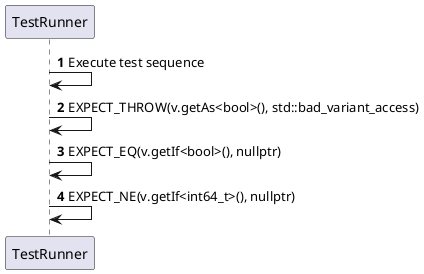

# Test Case: `VariantTest.ErrorHandlingAndSafety`

| Property | Value |
| :--- | :--- |
| **Module** | `coretypes` |
| **Source File** | `cmake-projects/coretypes/test/coretypes_variant_test.cpp` (lines 72–82) |
| **Category** | Unit & Regression Verification |
| **Traceability** | See module specification (`FE-*` / `TSK-*`) |
| **Async Telemetry** | Standard GTest / CTest stdout |

## Summary

Verifies that Variant correctly handles invalid type access and safe pointer retrieval.

## Sequence Diagram

## Observed Operations

- Invokes standalone executable entry flow.

## Verification Assertions

- `EXPECT_THROW(v.getAs<bool>(), std::bad_variant_access)`
- `EXPECT_EQ(v.getIf<bool>(), nullptr)`
- `EXPECT_NE(v.getIf<int64_t>(), nullptr)`

---

[Back to `coretypes` Tests Overview](../coretypes.md)
