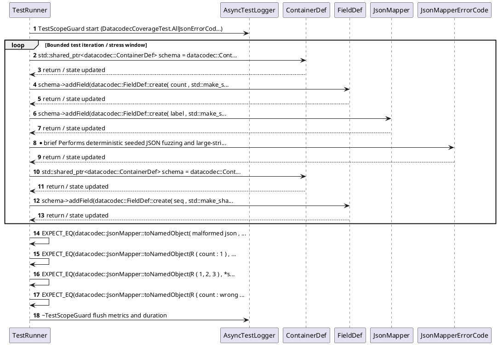

# Test Case: `DatacodecCoverageTest.AllJsonErrorCodesAndStringCodecBranches`

| Property | Value |
| :--- | :--- |
| **Module** | `datacodec` |
| **Source File** | `cmake-projects/datacodec/test/TestDatacodecExtended.cpp` (lines 233–292) |
| **Category** | Coverage, Enum, Boundary & Exception Containment (`CS-0100.1`, `CS-0100.3`, `CS-0100.4`, `CS-0100.6`, `CS-0100.9`) |
| **Traceability** | `TSK-20261113-004,`, `FE-0010,`, `CS-0090.1,` |
| **Async Telemetry** | Enabled (`TestScopeGuard` + `AsyncTestLogger`) |

## Summary

Tests every `JsonMapperErrorCode` branch, `StringCodec` modes, and malformed boundary payloads.

## Sequence Diagram

## Observed Operations

- `std::shared_ptr<datacodec::ContainerDef> schema = datacodec::ContainerDef::create("StrictPacket")`
- `schema->addField(datacodec::FieldDef::create("count", std::make_shared<datacodec::IntegerCodec<std::int32_t>>(32U), 0U))`
- `schema->addField(datacodec::FieldDef::create("label", std::make_shared<datacodec::StringCodec>(16U, true), 32U))`
- `* @brief Performs deterministic seeded JSON fuzzing and large-string stress testing (`CS-0100.10`, `CS-0100.23`).`
- `std::shared_ptr<datacodec::ContainerDef> schema = datacodec::ContainerDef::create("FuzzFrame")`
- `schema->addField(datacodec::FieldDef::create("seq", std::make_shared<datacodec::IntegerCodec<std::int64_t>>(64U), 0U))`
- `schema->addField(datacodec::FieldDef::create("val", std::make_shared<datacodec::FloatCodec<double>>(true), 64U))`
- `schema->addField(datacodec::FieldDef::create("msg", std::make_shared<datacodec::StringCodec>(), 128U))`

## Verification Assertions

- `EXPECT_EQ(datacodec::JsonMapper::toNamedObject("{malformed json", *schema).error(),`
- `EXPECT_EQ(datacodec::JsonMapper::toNamedObject(R"({"count": 1})", *schema).error(),`
- `EXPECT_EQ(datacodec::JsonMapper::toNamedObject(R"([1, 2, 3])", *schema).error(),`
- `EXPECT_EQ(datacodec::JsonMapper::toNamedObject(R"({"count": "wrong", "label": "ok"})", *schema).error(),`
- `EXPECT_EQ(datacodec::JsonMapper::toNamedObject(R"({"count": 5, "label": "ok", "extra": 9})", *schema).error(),`
- `EXPECT_EQ(dynamicStr.getBitSize(), 0U)`
- `EXPECT_NE(dynamicStr.decode(sSlice), nullptr)`
- `EXPECT_TRUE(res.has_value())`
- `EXPECT_TRUE(bigRes.has_value())`

---

[Back to `datacodec` Tests Overview](../datacodec.md)
