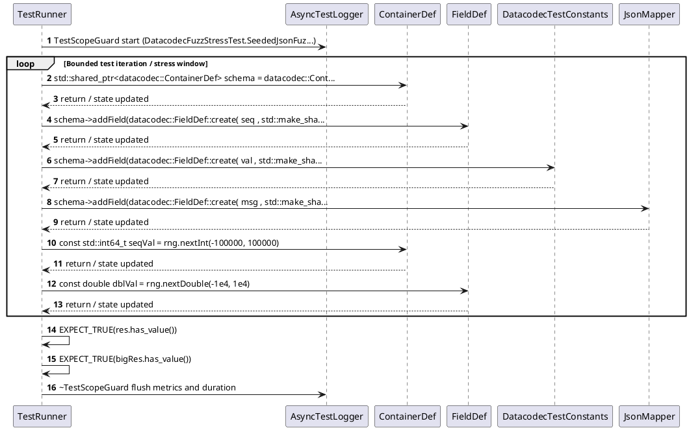

# Test Case: `DatacodecFuzzStressTest.SeededJsonFuzzAndLargeStringMemoryStress`

| Property | Value |
| :--- | :--- |
| **Module** | `datacodec` |
| **Source File** | `cmake-projects/datacodec/test/TestDatacodecExtended.cpp` (lines 264–290) |
| **Category** | Determinism, Fuzzing, Concurrency & Stress (`CS-0100.7`, `CS-0100.10`, `CS-0100.11`, `CS-0100.12`) |
| **Traceability** | `TSK-20261113-004,`, `FE-0010,`, `CS-0090.1,` |
| **Async Telemetry** | Enabled (`TestScopeGuard` + `AsyncTestLogger`) |

## Summary

Performs deterministic seeded JSON fuzzing and large-string stress testing (`CS-0100.10`, `CS-0100.23`).

## Sequence Diagram

## Observed Operations

- `std::shared_ptr<datacodec::ContainerDef> schema = datacodec::ContainerDef::create("FuzzFrame")`
- `schema->addField(datacodec::FieldDef::create("seq", std::make_shared<datacodec::IntegerCodec<std::int64_t>>(64U), 0U))`
- `schema->addField(datacodec::FieldDef::create("val", std::make_shared<datacodec::FloatCodec<double>>(true), 64U))`
- `schema->addField(datacodec::FieldDef::create("msg", std::make_shared<datacodec::StringCodec>(), 128U))`
- `const std::int64_t seqVal = rng.nextInt(-100000, 100000)`
- `const double dblVal = rng.nextDouble(-1e4, 1e4)`
- `const std::string txt = rng.nextAsciiString(12U)`

## Verification Assertions

- `EXPECT_TRUE(res.has_value())`
- `EXPECT_TRUE(bigRes.has_value())`

---

[Back to `datacodec` Tests Overview](../datacodec.md)
