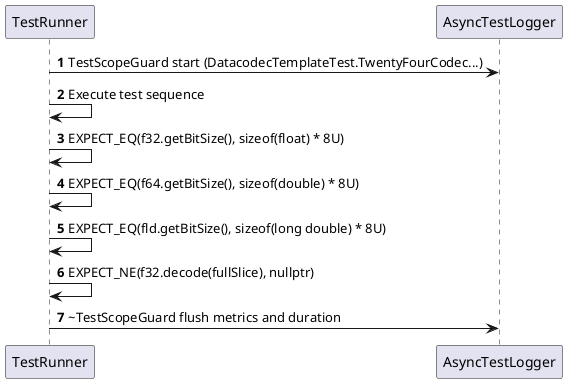

# Test Case: `DatacodecTemplateTest.TwentyFourCodecTemplateInstantiations`

| Property | Value |
| :--- | :--- |
| **Module** | `datacodec` |
| **Source File** | `cmake-projects/datacodec/test/TestDatacodecExtended.cpp` (lines 185–224) |
| **Category** | Template / Polymorphic Breadth (`CS-0100.5`) |
| **Traceability** | `TSK-20261113-004,`, `FE-0010,`, `CS-0090.1,` |
| **Async Telemetry** | Enabled (`TestScopeGuard` + `AsyncTestLogger`) |

## Summary

Exercises 24 distinct template instantiations of `IntegerCodec<T>` and `FloatCodec<T>`.

## Sequence Diagram

## Observed Operations

- Invokes standalone executable entry flow.

## Verification Assertions

- `EXPECT_EQ(f32.getBitSize(), sizeof(float) * 8U)`
- `EXPECT_EQ(f64.getBitSize(), sizeof(double) * 8U)`
- `EXPECT_EQ(fld.getBitSize(), sizeof(long double) * 8U)`
- `EXPECT_NE(f32.decode(fullSlice), nullptr)`
- `EXPECT_NE(f64.decode(fullSlice), nullptr)`
- `EXPECT_NE(fld.decode(fullSlice), nullptr)`

---

[Back to `datacodec` Tests Overview](../datacodec.md)
