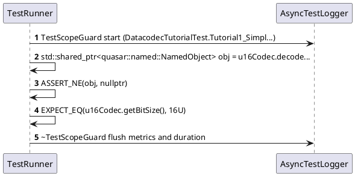

# Test Case: `DatacodecTutorialTest.Tutorial1_SimpleIntegerCodecAndSlice`

| Property | Value |
| :--- | :--- |
| **Module** | `datacodec` |
| **Source File** | `cmake-projects/datacodec/test/TestDatacodecExtended.cpp` (lines 102–111) |
| **Category** | Pedagogical Tutorial (`CS-0100.19`) |
| **Traceability** | `TSK-20261113-004,`, `FE-0010,`, `CS-0090.1,` |
| **Async Telemetry** | Enabled (`TestScopeGuard` + `AsyncTestLogger`) |

## Summary

Tutorial 1 (Basic): Decode a 16-bit integer codec from a `BitBufferSlice`.

## Sequence Diagram

## Observed Operations

- `std::shared_ptr<quasar::named::NamedObject> obj = u16Codec.decode(slice)`

## Verification Assertions

- `ASSERT_NE(obj, nullptr)`
- `EXPECT_EQ(u16Codec.getBitSize(), 16U)`

---

[Back to `datacodec` Tests Overview](../datacodec.md)
