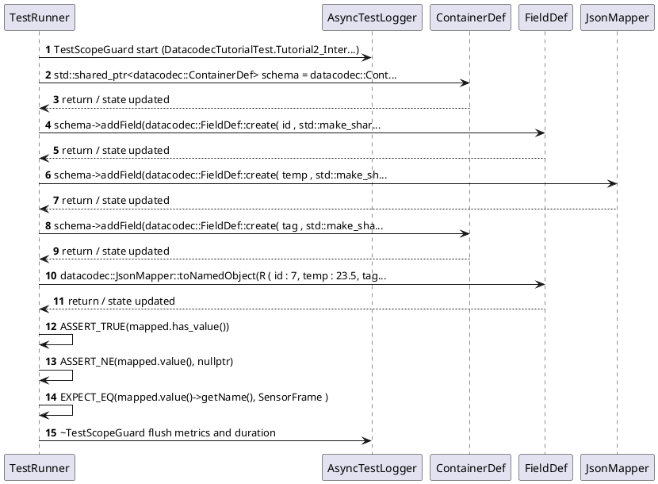

# Test Case: `DatacodecTutorialTest.Tutorial2_IntermediateContainerSchemaAndJson`

| Property | Value |
| :--- | :--- |
| **Module** | `datacodec` |
| **Source File** | `cmake-projects/datacodec/test/TestDatacodecExtended.cpp` (lines 120–132) |
| **Category** | Pedagogical Tutorial (`CS-0100.19`) |
| **Traceability** | `TSK-20261113-004,`, `FE-0010,`, `CS-0090.1,` |
| **Async Telemetry** | Enabled (`TestScopeGuard` + `AsyncTestLogger`) |

## Summary

Tutorial 2 (Intermediate): Build a `ContainerDef` schema and validate JSON objects with `JsonMapper`.

## Sequence Diagram

## Observed Operations

- `std::shared_ptr<datacodec::ContainerDef> schema = datacodec::ContainerDef::create("SensorFrame")`
- `schema->addField(datacodec::FieldDef::create("id", std::make_shared<datacodec::IntegerCodec<std::uint32_t>>(32U), 0U))`
- `schema->addField(datacodec::FieldDef::create("temp", std::make_shared<datacodec::FloatCodec<double>>(true), 32U))`
- `schema->addField(datacodec::FieldDef::create("tag", std::make_shared<datacodec::StringCodec>(32U, true), 96U))`
- `datacodec::JsonMapper::toNamedObject(R"({"id": 7, "temp": 23.5, "tag": "OK"})", *schema)`

## Verification Assertions

- `ASSERT_TRUE(mapped.has_value())`
- `ASSERT_NE(mapped.value(), nullptr)`
- `EXPECT_EQ(mapped.value()->getName(), "SensorFrame")`

---

[Back to `datacodec` Tests Overview](../datacodec.md)
