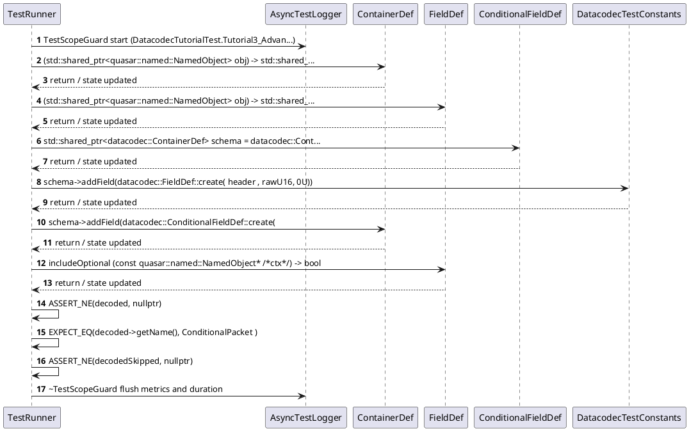

# Test Case: `DatacodecTutorialTest.Tutorial3_AdvancedConditionalAndTransformMapper`

| Property | Value |
| :--- | :--- |
| **Module** | `datacodec` |
| **Source File** | `cmake-projects/datacodec/test/TestDatacodecExtended.cpp` (lines 141–172) |
| **Category** | Pedagogical Tutorial (`CS-0100.19`) |
| **Traceability** | `TSK-20261113-004,`, `FE-0010,`, `CS-0090.1,` |
| **Async Telemetry** | Enabled (`TestScopeGuard` + `AsyncTestLogger`) |

## Summary

Tutorial 3 (Advanced): Compose `ConditionalFieldDef`, `TransformCodec`, and `BinaryMapper`.

## Sequence Diagram

## Observed Operations

- ` -> std::shared_ptr<quasar::named::NamedObject> {`
- ` -> std::shared_ptr<quasar::named::NamedObject> {`
- `std::shared_ptr<datacodec::ContainerDef> schema = datacodec::ContainerDef::create("ConditionalPacket")`
- `schema->addField(datacodec::FieldDef::create("header", rawU16, 0U))`
- `schema->addField(datacodec::ConditionalFieldDef::create(`
- `[&includeOptional](const quasar::named::NamedObject* /*ctx*/) -> bool {`

## Verification Assertions

- `ASSERT_NE(decoded, nullptr)`
- `EXPECT_EQ(decoded->getName(), "ConditionalPacket")`
- `ASSERT_NE(decodedSkipped, nullptr)`

---

[Back to `datacodec` Tests Overview](../datacodec.md)
