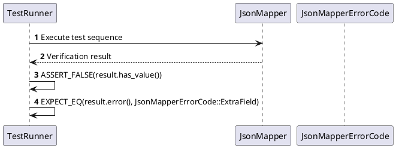

# Test Case: `JsonMapperTest.ExtraField`

| Property | Value |
| :--- | :--- |
| **Module** | `datacodec` |
| **Source File** | `cmake-projects/datacodec/test/TestJsonMapper.cpp` (lines 151–158) |
| **Category** | Unit & Regression Verification |
| **Traceability** | `TSK-20261113-003,`, `FE-0010,` |
| **Async Telemetry** | Standard GTest / CTest stdout |

## Summary

Verifies unexpected JSON keys yield JsonMapperErrorCode::ExtraField.

## Sequence Diagram

## Observed Operations

- Invokes standalone executable entry flow.

## Verification Assertions

- `ASSERT_FALSE(result.has_value())`
- `EXPECT_EQ(result.error(), JsonMapperErrorCode::ExtraField)`

---

[Back to `datacodec` Tests Overview](../datacodec.md)
