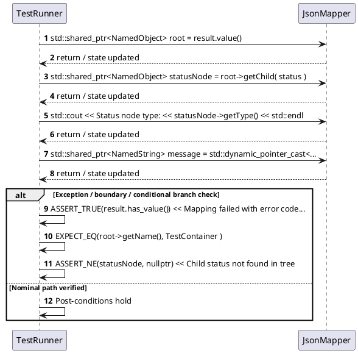

# Test Case: `JsonMapperTest.ValidMapping`

| Property | Value |
| :--- | :--- |
| **Module** | `datacodec` |
| **Source File** | `cmake-projects/datacodec/test/TestJsonMapper.cpp` (lines 73–110) |
| **Category** | Unit & Regression Verification |
| **Traceability** | `TSK-20261113-003,`, `FE-0010,` |
| **Async Telemetry** | Standard GTest / CTest stdout |

## Summary

Verifies valid JSON object mapping produces populated NamedObject root and typed children.

## Sequence Diagram

## Observed Operations

- `std::shared_ptr<NamedObject> root = result.value()`
- `std::shared_ptr<NamedObject> statusNode = root->getChild("status")`
- `std::cout << "Status node type: " << statusNode->getType() << std::endl`
- `std::shared_ptr<NamedString> message = std::dynamic_pointer_cast<NamedString>(root->getChild("message"))`

## Verification Assertions

- `ASSERT_TRUE(result.has_value()) << "Mapping failed with error code: " << static_cast<int>(result.error())`
- `EXPECT_EQ(root->getName(), "TestContainer")`
- `ASSERT_NE(statusNode, nullptr) << "Child 'status' not found in tree"`
- `ASSERT_NE(statusL, nullptr) << "Child 'status' is not a NamedInteger of any expected width. Type: " << statusNode->getType()`
- `EXPECT_EQ(statusL->value(), 200)`
- `EXPECT_EQ(statusU->value(), 200)`
- `EXPECT_EQ(status->value(), 200)`
- `ASSERT_NE(message, nullptr) << "Child 'message' is not a NamedString"`
- `EXPECT_EQ(message->toString(), "OK")`

---

[Back to `datacodec` Tests Overview](../datacodec.md)
