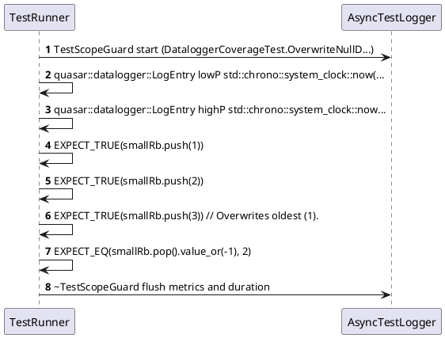

# Test Case: `DataloggerCoverageTest.OverwriteNullDataViewAndTriggerBelowMode`

| Property | Value |
| :--- | :--- |
| **Module** | `datalogger` |
| **Source File** | `cmake-projects/datalogger/test_cs0100/TestDataloggerExtended.cpp` (lines 230–247) |
| **Category** | Coverage, Enum, Boundary & Exception Containment (`CS-0100.1`, `CS-0100.3`, `CS-0100.4`, `CS-0100.6`, `CS-0100.9`) |
| **Traceability** | `TSK-20261113-004,`, `FE-0160`, `CS-0090.1,` |
| **Async Telemetry** | Enabled (`TestScopeGuard` + `AsyncTestLogger`) |

## Summary

Exercises `RingBuffer` overwrite, `ValueThresholdTrigger` below-mode, and `DataView` null target.

## Sequence Diagram

## Observed Operations

- `quasar::datalogger::LogEntry lowP{std::chrono::system_clock::now(), quasar::datalogger::DataSample{"Pressure", 4.0}}`
- `quasar::datalogger::LogEntry highP{std::chrono::system_clock::now(), quasar::datalogger::DataSample{"Pressure", 20.0}}`

## Verification Assertions

- `EXPECT_TRUE(smallRb.push(1))`
- `EXPECT_TRUE(smallRb.push(2))`
- `EXPECT_TRUE(smallRb.push(3)); // Overwrites oldest (1).`
- `EXPECT_EQ(smallRb.pop().value_or(-1), 2)`
- `EXPECT_EQ(smallRb.pop().value_or(-1), 3)`
- `EXPECT_FALSE(nullView.sample().has_value())`
- `EXPECT_TRUE(belowTrig.process(lowP).has_value())`
- `EXPECT_FALSE(belowTrig.process(highP).has_value())`

---

[Back to `datalogger` Tests Overview](../datalogger.md)
