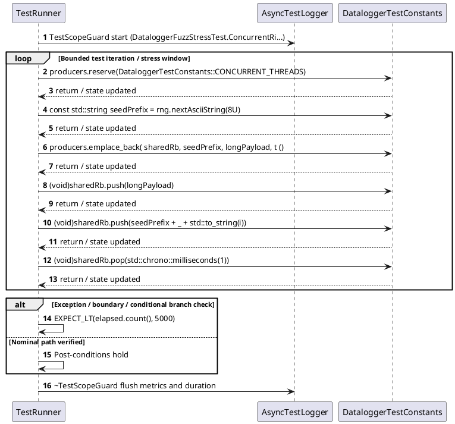

# Test Case: `DataloggerFuzzStressTest.ConcurrentRingBufferAndLongPayloadStress`

| Property | Value |
| :--- | :--- |
| **Module** | `datalogger` |
| **Source File** | `cmake-projects/datalogger/test_cs0100/TestDataloggerExtended.cpp` (lines 256–289) |
| **Category** | Determinism, Fuzzing, Concurrency & Stress (`CS-0100.7`, `CS-0100.10`, `CS-0100.11`, `CS-0100.12`) |
| **Traceability** | `TSK-20261113-004,`, `FE-0160`, `CS-0090.1,` |
| **Async Telemetry** | Enabled (`TestScopeGuard` + `AsyncTestLogger`) |

## Summary

Multi-threaded stress test verifying lock/deadlock safety and large string memory handling.

## Sequence Diagram

## Observed Operations

- `producers.reserve(DataloggerTestConstants::CONCURRENT_THREADS)`
- `const std::string seedPrefix = rng.nextAsciiString(8U)`
- `producers.emplace_back([&sharedRb, seedPrefix, &longPayload, t]() {`
- `(void)sharedRb.push(longPayload)`
- `(void)sharedRb.push(seedPrefix + "_" + std::to_string(i))`
- `(void)sharedRb.pop(std::chrono::milliseconds(1))`
- `producers[t].join()`

## Verification Assertions

- `EXPECT_LT(elapsed.count(), 5000)`

---

[Back to `datalogger` Tests Overview](../datalogger.md)
