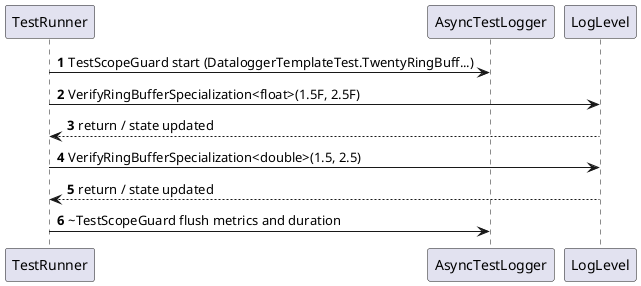

# Test Case: `DataloggerTemplateTest.TwentyRingBufferInstantiations`

| Property | Value |
| :--- | :--- |
| **Module** | `datalogger` |
| **Source File** | `cmake-projects/datalogger/test_cs0100/TestDataloggerExtended.cpp` (lines 198–221) |
| **Category** | Template / Polymorphic Breadth (`CS-0100.5`) |
| **Traceability** | `TSK-20261113-004,`, `FE-0160`, `CS-0090.1,` |
| **Async Telemetry** | Enabled (`TestScopeGuard` + `AsyncTestLogger`) |

## Summary

Tests 20 distinct template instantiations of `quasar::datalogger::RingBuffer<T>`.

## Sequence Diagram

## Observed Operations

- `VerifyRingBufferSpecialization<float>(1.5F, 2.5F)`
- `VerifyRingBufferSpecialization<double>(1.5, 2.5)`

## Verification Assertions

- Verified via exit status `0` and runtime checks inside executable.

---

[Back to `datalogger` Tests Overview](../datalogger.md)
