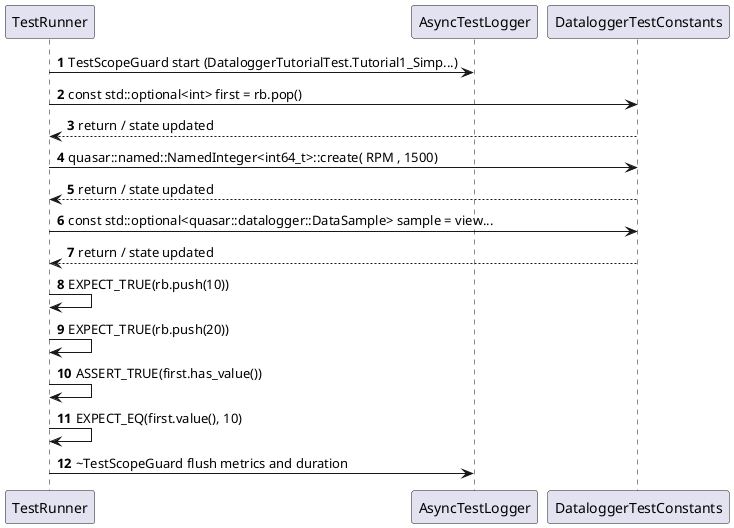

# Test Case: `DataloggerTutorialTest.Tutorial1_SimpleRingBufferAndDataView`

| Property | Value |
| :--- | :--- |
| **Module** | `datalogger` |
| **Source File** | `cmake-projects/datalogger/test_cs0100/TestDataloggerExtended.cpp` (lines 98–115) |
| **Category** | Pedagogical Tutorial (`CS-0100.19`) |
| **Traceability** | `TSK-20261113-004,`, `FE-0160`, `CS-0090.1,` |
| **Async Telemetry** | Enabled (`TestScopeGuard` + `AsyncTestLogger`) |

## Summary

Tutorial 1 (Basic): Push/pop samples in `RingBuffer` and sample a `NamedObject` via `DataView`.

## Sequence Diagram

## Observed Operations

- `const std::optional<int> first = rb.pop()`
- `quasar::named::NamedInteger<int64_t>::create("RPM", 1500)`
- `const std::optional<quasar::datalogger::DataSample> sample = view.sample()`

## Verification Assertions

- `EXPECT_TRUE(rb.push(10))`
- `EXPECT_TRUE(rb.push(20))`
- `ASSERT_TRUE(first.has_value())`
- `EXPECT_EQ(first.value(), 10)`
- `ASSERT_TRUE(sample.has_value())`
- `EXPECT_EQ(sample.value().sourcePath, "RPM")`
- `EXPECT_TRUE(std::holds_alternative<double>(sample.value().value))`

---

[Back to `datalogger` Tests Overview](../datalogger.md)
