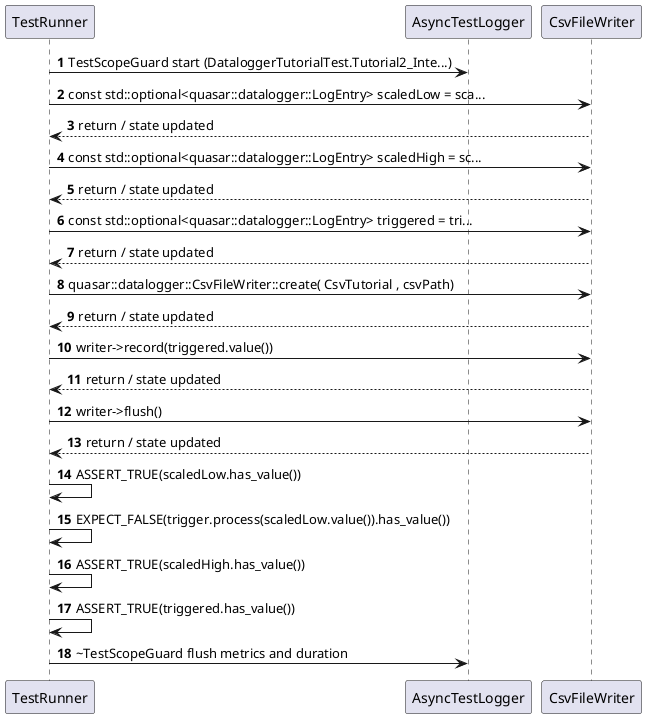

# Test Case: `DataloggerTutorialTest.Tutorial2_IntermediateFilterTriggerAndCsvWriter`

| Property | Value |
| :--- | :--- |
| **Module** | `datalogger` |
| **Source File** | `cmake-projects/datalogger/test_cs0100/TestDataloggerExtended.cpp` (lines 124–155) |
| **Category** | Pedagogical Tutorial (`CS-0100.19`) |
| **Traceability** | `TSK-20261113-004,`, `FE-0160`, `CS-0090.1,` |
| **Async Telemetry** | Enabled (`TestScopeGuard` + `AsyncTestLogger`) |

## Summary

Tutorial 2 (Intermediate): Chain `MathFilter`, `ValueThresholdTrigger`, and `CsvFileWriter`.

## Sequence Diagram

## Observed Operations

- `const std::optional<quasar::datalogger::LogEntry> scaledLow = scaleFilter.process(lowEntry)`
- `const std::optional<quasar::datalogger::LogEntry> scaledHigh = scaleFilter.process(highEntry)`
- `const std::optional<quasar::datalogger::LogEntry> triggered = trigger.process(scaledHigh.value())`
- `quasar::datalogger::CsvFileWriter::create("CsvTutorial", csvPath)`
- `writer->record(triggered.value())`
- `writer->flush()`

## Verification Assertions

- `ASSERT_TRUE(scaledLow.has_value())`
- `EXPECT_FALSE(trigger.process(scaledLow.value()).has_value())`
- `ASSERT_TRUE(scaledHigh.has_value())`
- `ASSERT_TRUE(triggered.has_value())`
- `EXPECT_TRUE(std::filesystem::exists(csvPath))`

---

[Back to `datalogger` Tests Overview](../datalogger.md)
