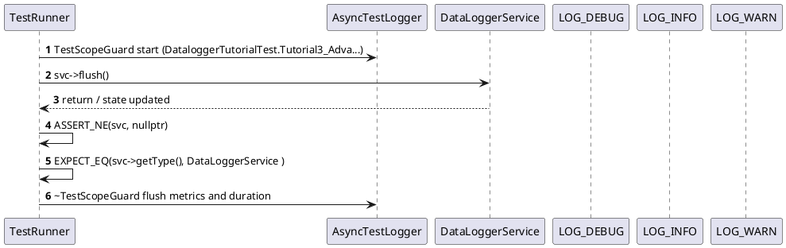

# Test Case: `DataloggerTutorialTest.Tutorial3_AdvancedServiceLifecycleAndLogMacros`

| Property | Value |
| :--- | :--- |
| **Module** | `datalogger` |
| **Source File** | `cmake-projects/datalogger/test_cs0100/TestDataloggerExtended.cpp` (lines 164–185) |
| **Category** | Pedagogical Tutorial (`CS-0100.19`) |
| **Traceability** | `TSK-20261113-004,`, `FE-0160`, `CS-0090.1,` |
| **Async Telemetry** | Enabled (`TestScopeGuard` + `AsyncTestLogger`) |

## Summary

Tutorial 3 (Advanced): Configure singleton `DataLoggerService` via `initDefault` and invoke `LOG_*` macros.

## Sequence Diagram

## Observed Operations

- `svc->flush()`

## Verification Assertions

- `ASSERT_NE(svc, nullptr)`
- `EXPECT_EQ(svc->getType(), "DataLoggerService")`

---

[Back to `datalogger` Tests Overview](../datalogger.md)
