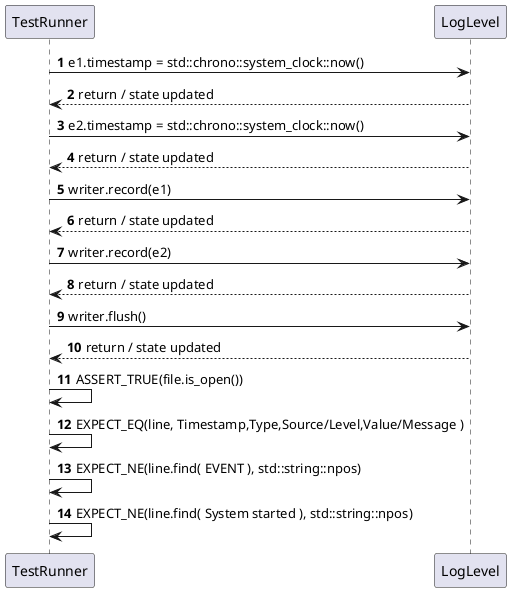

# Test Case: `TestCsvFileWriter.WriteEventAndData`

| Property | Value |
| :--- | :--- |
| **Module** | `datalogger` |
| **Source File** | `cmake-projects/datalogger/test/TestCsvFileWriter.cpp` (lines 24–59) |
| **Category** | Unit & Regression Verification |
| **Traceability** | See module specification (`FE-*` / `TSK-*`) |
| **Async Telemetry** | Standard GTest / CTest stdout |

## Summary

Executes verification scenario `TestCsvFileWriter.WriteEventAndData` defined in `cmake-projects/datalogger/test/TestCsvFileWriter.cpp`.

## Sequence Diagram

## Observed Operations

- `e1.timestamp = std::chrono::system_clock::now()`
- `e2.timestamp = std::chrono::system_clock::now()`
- `writer.record(e1)`
- `writer.record(e2)`
- `writer.flush()`

## Verification Assertions

- `ASSERT_TRUE(file.is_open())`
- `EXPECT_EQ(line, "Timestamp,Type,Source/Level,Value/Message")`
- `EXPECT_NE(line.find("EVENT"), std::string::npos)`
- `EXPECT_NE(line.find("System started"), std::string::npos)`
- `EXPECT_NE(line.find("DATA"), std::string::npos)`
- `EXPECT_NE(line.find("Sensor/Temp"), std::string::npos)`
- `EXPECT_NE(line.find("24.5"), std::string::npos)`

---

[Back to `datalogger` Tests Overview](../datalogger.md)
