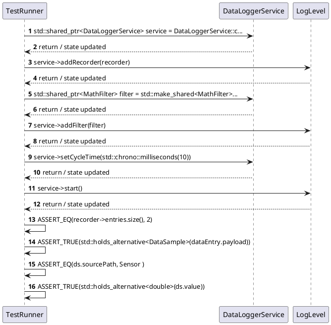

# Test Case: `TestDataLoggerService.PipelineTest`

| Property | Value |
| :--- | :--- |
| **Module** | `datalogger` |
| **Source File** | `cmake-projects/datalogger/test/TestDataLoggerService.cpp` (lines 18–54) |
| **Category** | Unit & Regression Verification |
| **Traceability** | See module specification (`FE-*` / `TSK-*`) |
| **Async Telemetry** | Standard GTest / CTest stdout |

## Summary

Executes verification scenario `TestDataLoggerService.PipelineTest` defined in `cmake-projects/datalogger/test/TestDataLoggerService.cpp`.

## Sequence Diagram

## Observed Operations

- `std::shared_ptr<DataLoggerService> service = DataLoggerService::create("LogService", 1024)`
- `service->addRecorder(recorder)`
- `std::shared_ptr<MathFilter> filter = std::make_shared<MathFilter>("Sensor", 2.0, 10.0)`
- `service->addFilter(filter)`
- `service->setCycleTime(std::chrono::milliseconds(10))`
- `service->start()`
- `e.timestamp = std::chrono::system_clock::now()`
- `service->log(e)`

## Verification Assertions

- `ASSERT_EQ(recorder->entries.size(), 2)`
- `ASSERT_TRUE(std::holds_alternative<DataSample>(dataEntry.payload))`
- `ASSERT_EQ(ds.sourcePath, "Sensor")`
- `ASSERT_TRUE(std::holds_alternative<double>(ds.value))`
- `EXPECT_DOUBLE_EQ(std::get<double>(ds.value), 20.0); // 5 * 2 + 10`
- `ASSERT_TRUE(std::holds_alternative<EventLog>(evEntry.payload))`
- `EXPECT_EQ(ev.level, LogLevel::INFO)`
- `EXPECT_EQ(ev.message, "Processing started")`

---

[Back to `datalogger` Tests Overview](../datalogger.md)
