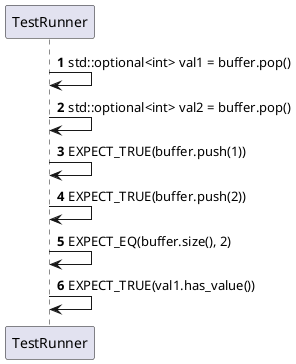

# Test Case: `TestDataloggerRingBuffer.BasicPushPop`

| Property | Value |
| :--- | :--- |
| **Module** | `datalogger` |
| **Source File** | `cmake-projects/datalogger/test/TestDataloggerRingBuffer.cpp` (lines 9–24) |
| **Category** | Unit & Regression Verification |
| **Traceability** | See module specification (`FE-*` / `TSK-*`) |
| **Async Telemetry** | Standard GTest / CTest stdout |

## Summary

Executes verification scenario `TestDataloggerRingBuffer.BasicPushPop` defined in `cmake-projects/datalogger/test/TestDataloggerRingBuffer.cpp`.

## Sequence Diagram

## Observed Operations

- `std::optional<int> val1 = buffer.pop()`
- `std::optional<int> val2 = buffer.pop()`

## Verification Assertions

- `EXPECT_TRUE(buffer.push(1))`
- `EXPECT_TRUE(buffer.push(2))`
- `EXPECT_EQ(buffer.size(), 2)`
- `EXPECT_TRUE(val1.has_value())`
- `EXPECT_EQ(val1.value(), 1)`
- `EXPECT_TRUE(val2.has_value())`
- `EXPECT_EQ(val2.value(), 2)`
- `EXPECT_EQ(buffer.size(), 0)`

---

[Back to `datalogger` Tests Overview](../datalogger.md)
