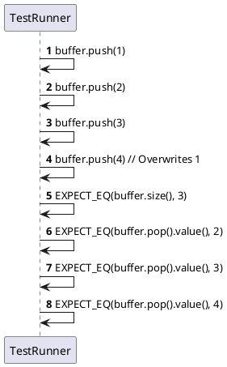

# Test Case: `TestDataloggerRingBuffer.CapacityOverwrite`

| Property | Value |
| :--- | :--- |
| **Module** | `datalogger` |
| **Source File** | `cmake-projects/datalogger/test/TestDataloggerRingBuffer.cpp` (lines 26–38) |
| **Category** | Unit & Regression Verification |
| **Traceability** | See module specification (`FE-*` / `TSK-*`) |
| **Async Telemetry** | Standard GTest / CTest stdout |

## Summary

Executes verification scenario `TestDataloggerRingBuffer.CapacityOverwrite` defined in `cmake-projects/datalogger/test/TestDataloggerRingBuffer.cpp`.

## Sequence Diagram

## Observed Operations

- `buffer.push(1)`
- `buffer.push(2)`
- `buffer.push(3)`
- `buffer.push(4); // Overwrites 1`

## Verification Assertions

- `EXPECT_EQ(buffer.size(), 3)`
- `EXPECT_EQ(buffer.pop().value(), 2)`
- `EXPECT_EQ(buffer.pop().value(), 3)`
- `EXPECT_EQ(buffer.pop().value(), 4)`
- `EXPECT_FALSE(buffer.pop().has_value())`

---

[Back to `datalogger` Tests Overview](../datalogger.md)
