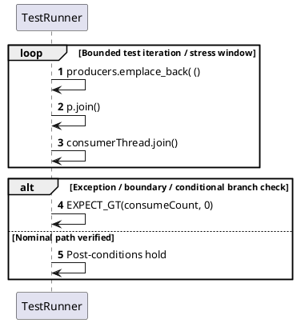

# Test Case: `TestDataloggerStress.RingBufferMultithread`

| Property | Value |
| :--- | :--- |
| **Module** | `datalogger` |
| **Source File** | `cmake-projects/datalogger/test/TestDataloggerStress.cpp` (lines 13–50) |
| **Category** | Determinism, Fuzzing, Concurrency & Stress (`CS-0100.7`, `CS-0100.10`, `CS-0100.11`, `CS-0100.12`) |
| **Traceability** | See module specification (`FE-*` / `TSK-*`) |
| **Async Telemetry** | Standard GTest / CTest stdout |

## Summary

Executes verification scenario `TestDataloggerStress.RingBufferMultithread` defined in `cmake-projects/datalogger/test/TestDataloggerStress.cpp`.

## Sequence Diagram

## Observed Operations

- `producers.emplace_back([&]() {`
- `p.join()`
- `consumerThread.join()`

## Verification Assertions

- `EXPECT_GT(consumeCount, 0)`

---

[Back to `datalogger` Tests Overview](../datalogger.md)
