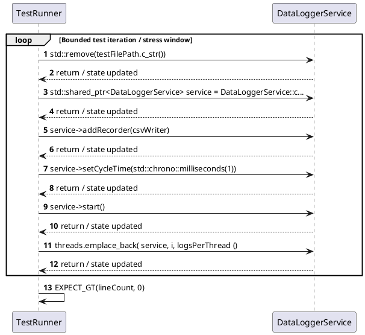

# Test Case: `TestDataloggerStress.ServiceHeavyLoad`

| Property | Value |
| :--- | :--- |
| **Module** | `datalogger` |
| **Source File** | `cmake-projects/datalogger/test/TestDataloggerStress.cpp` (lines 52–95) |
| **Category** | Determinism, Fuzzing, Concurrency & Stress (`CS-0100.7`, `CS-0100.10`, `CS-0100.11`, `CS-0100.12`) |
| **Traceability** | See module specification (`FE-*` / `TSK-*`) |
| **Async Telemetry** | Standard GTest / CTest stdout |

## Summary

Executes verification scenario `TestDataloggerStress.ServiceHeavyLoad` defined in `cmake-projects/datalogger/test/TestDataloggerStress.cpp`.

## Sequence Diagram

## Observed Operations

- `std::remove(testFilePath.c_str())`
- `std::shared_ptr<DataLoggerService> service = DataLoggerService::create("StressService", 50000)`
- `service->addRecorder(csvWriter)`
- `service->setCycleTime(std::chrono::milliseconds(1))`
- `service->start()`
- `threads.emplace_back([&service, i, logsPerThread]() {`
- `e.timestamp = std::chrono::system_clock::now()`
- `e.payload = DataSample{"Stress/Thread" + std::to_string(i), static_cast<double>(j)}`

## Verification Assertions

- `EXPECT_GT(lineCount, 0)`

---

[Back to `datalogger` Tests Overview](../datalogger.md)
