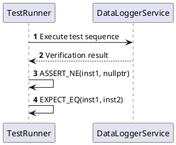

# Test Case: `TestLogMacros.SingletonInstanceStability`

| Property | Value |
| :--- | :--- |
| **Module** | `datalogger` |
| **Source File** | `cmake-projects/datalogger/test/TestLogMacros.cpp` (lines 78–85) |
| **Category** | Unit & Regression Verification |
| **Traceability** | See module specification (`FE-*` / `TSK-*`) |
| **Async Telemetry** | Standard GTest / CTest stdout |

## Summary

Executes verification scenario `TestLogMacros.SingletonInstanceStability` defined in `cmake-projects/datalogger/test/TestLogMacros.cpp`.

## Sequence Diagram

## Observed Operations

- Invokes standalone executable entry flow.

## Verification Assertions

- `ASSERT_NE(inst1, nullptr)`
- `EXPECT_EQ(inst1, inst2)`

---

[Back to `datalogger` Tests Overview](../datalogger.md)
