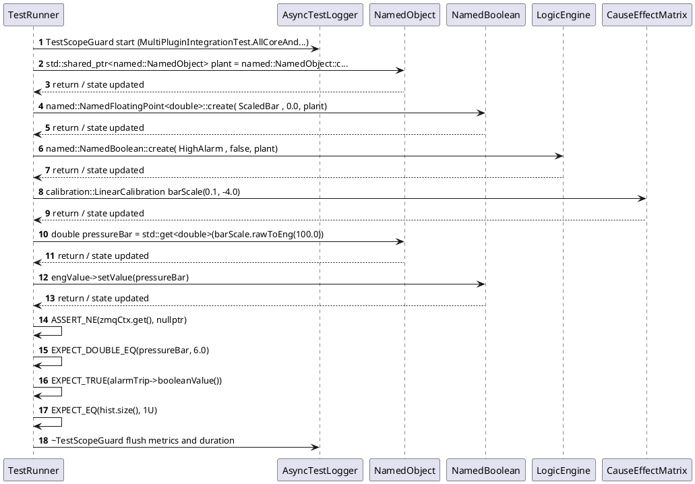

# Test Case: `MultiPluginIntegrationTest.AllCoreAndThirdPartySubsystemsTogether`

| Property | Value |
| :--- | :--- |
| **Module** | `integration-tests` |
| **Source File** | `cmake-projects/integration-tests/TestIntegrationMultiPlugin.cpp` (lines 65–125) |
| **Category** | Cross-Module / Third-Party Integration (`CS-0100.16`–`CS-0100.18`) |
| **Traceability** | `[TSK-20260328-001]`, `[FE-0130]`, `[FE-0200]`, `[FE-0240]`, `[CS-0040.2]` |
| **Async Telemetry** | Enabled (`TestScopeGuard` + `AsyncTestLogger`) |

## Summary

Multi-module and multi-third-party simultaneously executing integration test (`CS-0100.16`, `CS-0100.18`).

## Sequence Diagram

## Observed Operations

- `std::shared_ptr<named::NamedObject> plant = named::NamedObject::create("PlantRoot")`
- `named::NamedFloatingPoint<double>::create("ScaledBar", 0.0, plant)`
- `named::NamedBoolean::create("HighAlarm", false, plant)`
- `calibration::LinearCalibration barScale(0.1, -4.0)`
- `double pressureBar = std::get<double>(barScale.rawToEng(100.0))`
- `engValue->setValue(pressureBar)`
- `std::shared_ptr<logic::LogicEngine> engine = logic::LogicEngine::create("SafetyEngine")`
- `logic::CauseEffectMatrix::create("TripCem", 2U, 1U)`

## Verification Assertions

- `ASSERT_NE(zmqCtx.get(), nullptr)`
- `EXPECT_DOUBLE_EQ(pressureBar, 6.0)`
- `EXPECT_TRUE(alarmTrip->booleanValue())`
- `EXPECT_EQ(hist.size(), 1U)`
- `EXPECT_EQ(static_cast<int>(luaSvc->getEngine()->getState()["integVar"]), 2026)`
- `EXPECT_FALSE(json.empty())`
- `EXPECT_FALSE(yaml.empty())`
- `EXPECT_FALSE(xml.empty())`

---

[Back to `integration-tests` Tests Overview](../integration-tests.md)
