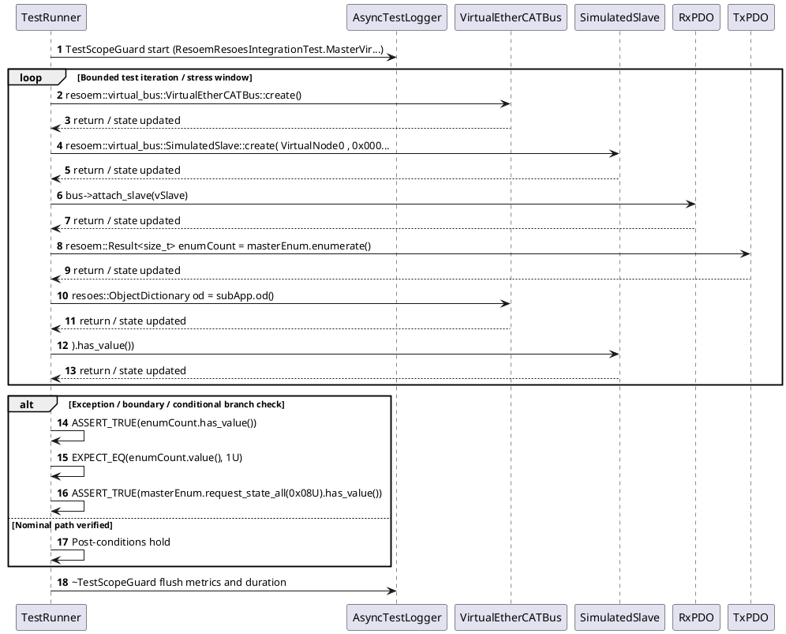

# Test Case: `ResoemResoesIntegrationTest.MasterVirtualBusAndSubDeviceCoeBridge`

| Property | Value |
| :--- | :--- |
| **Module** | `integration-tests` |
| **Source File** | `cmake-projects/integration-tests/TestIntegrationResoemResoes.cpp` (lines 38–112) |
| **Category** | Cross-Module / Third-Party Integration (`CS-0100.16`–`CS-0100.18`) |
| **Traceability** | `[TSK-20260920-001]`, `[TSK-20261113-001]`, `[FE-0040]`, `[FE-0280]`, `[CS-0010.37]` |
| **Async Telemetry** | Enabled (`TestScopeGuard` + `AsyncTestLogger`) |

## Summary

Cross-module integration test coupling `resoem` EtherCAT Master stack with `resoes` SubDevice stack (`CS-0100.16`, `CS-0100.18`).

## Sequence Diagram

## Observed Operations

- `resoem::virtual_bus::VirtualEtherCATBus::create()`
- `resoem::virtual_bus::SimulatedSlave::create("VirtualNode0", 0x00000002U, 0x044C2C52U, 0x00100000U, 100U)`
- `bus->attach_slave(vSlave)`
- `resoem::Result<size_t> enumCount = masterEnum.enumerate()`
- `resoes::ObjectDictionary& od = subApp.od()`
- `}).has_value())`
- `}).has_value())`
- `}).has_value())`

## Verification Assertions

- `ASSERT_TRUE(enumCount.has_value())`
- `EXPECT_EQ(enumCount.value(), 1U)`
- `ASSERT_TRUE(masterEnum.request_state_all(0x08U).has_value())`
- `ASSERT_TRUE(subApp.init().has_value())`
- `ASSERT_TRUE(od.register_object(resoes::OdObjectEntry{`
- `ASSERT_TRUE(od.register_object(resoes::OdObjectEntry{`
- `ASSERT_TRUE(od.register_object(resoes::OdObjectEntry{`
- `EXPECT_EQ(rxBusFrame.size(), fb.buffer().size())`
- `ASSERT_TRUE(subApp.coe().unpack_rx_pdo(std::as_bytes(std::span<const resoem::byte>(frameBytes))).has_value())`
- `ASSERT_TRUE(stored.has_value())`

---

[Back to `integration-tests` Tests Overview](../integration-tests.md)
