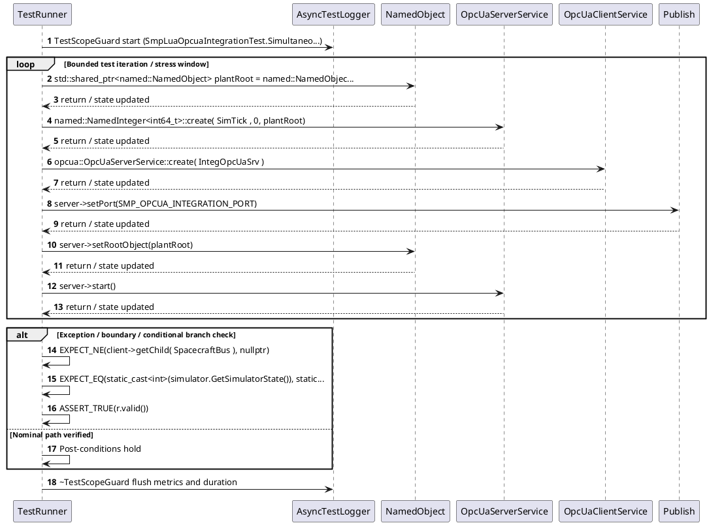

# Test Case: `SmpLuaOpcuaIntegrationTest.SimultaneousSmpLuaAndOpcUaPipeline`

| Property | Value |
| :--- | :--- |
| **Module** | `integration-tests` |
| **Source File** | `cmake-projects/integration-tests/TestIntegrationSmpLuaOpcua.cpp` (lines 52–105) |
| **Category** | Cross-Module / Third-Party Integration (`CS-0100.16`–`CS-0100.18`) |
| **Traceability** | `[TSK-20260311-005]`, `[FE-0070]`, `[FE-0130]`, `[FE-0200]`, `[CS-0040.2]`, `[CS-0010.37]` |
| **Async Telemetry** | Enabled (`TestScopeGuard` + `AsyncTestLogger`) |

## Summary

Cross-module integration test combining ECSS SMP `Simulator`, `quasar_scripting` Lua, and `quasar_opcua` server/client (`CS-0100.16`, `CS-0100.18`).

## Sequence Diagram

## Observed Operations

- `std::shared_ptr<named::NamedObject> plantRoot = named::NamedObject::create("SpacecraftBus")`
- `named::NamedInteger<int64_t>::create("SimTick", 0, plantRoot)`
- `opcua::OpcUaServerService::create("IntegOpcUaSrv")`
- `server->setPort(SMP_OPCUA_INTEGRATION_PORT)`
- `server->setRootObject(plantRoot)`
- `server->start()`
- `(void)waitCv.wait_for(lock, OPCUA_READY_WAIT_MS)`
- `opcua::OpcUaClientService::create("IntegOpcUaCli")`

## Verification Assertions

- `EXPECT_NE(client->getChild("SpacecraftBus"), nullptr)`
- `EXPECT_EQ(static_cast<int>(simulator.GetSimulatorState()), static_cast<int>(Smp::SimulatorStateKind::SSK_Standby))`
- `ASSERT_TRUE(r.valid())`
- `EXPECT_EQ(telemetryTick->value(), 100)`

---

[Back to `integration-tests` Tests Overview](../integration-tests.md)
