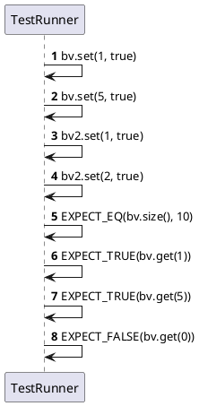

# Test Case: `BitVectorTest.BasicOperations`

| Property | Value |
| :--- | :--- |
| **Module** | `logicengine` |
| **Source File** | `cmake-projects/logicengine/test/LogicEngineTest.cpp` (lines 8–33) |
| **Category** | Unit & Regression Verification |
| **Traceability** | See module specification (`FE-*` / `TSK-*`) |
| **Async Telemetry** | Standard GTest / CTest stdout |

## Summary

Executes verification scenario `BitVectorTest.BasicOperations` defined in `cmake-projects/logicengine/test/LogicEngineTest.cpp`.

## Sequence Diagram

## Observed Operations

- `bv.set(1, true)`
- `bv.set(5, true)`
- `bv2.set(1, true)`
- `bv2.set(2, true)`

## Verification Assertions

- `EXPECT_EQ(bv.size(), 10)`
- `EXPECT_TRUE(bv.get(1))`
- `EXPECT_TRUE(bv.get(5))`
- `EXPECT_FALSE(bv.get(0))`
- `EXPECT_TRUE(bv.any())`
- `EXPECT_TRUE(andResult.get(1))`
- `EXPECT_FALSE(andResult.get(5))`
- `EXPECT_FALSE(andResult.get(2))`
- `EXPECT_TRUE(orResult.get(1))`
- `EXPECT_TRUE(orResult.get(2))`

---

[Back to `logicengine` Tests Overview](../logicengine.md)
