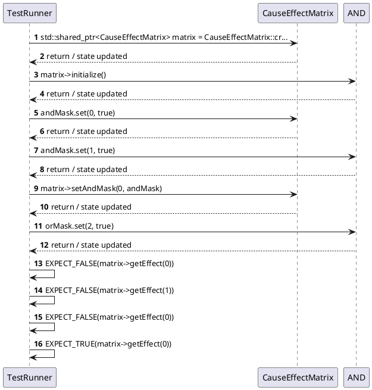

# Test Case: `CauseEffectMatrixTest.Evaluation`

| Property | Value |
| :--- | :--- |
| **Module** | `logicengine` |
| **Source File** | `cmake-projects/logicengine/test/LogicEngineTest.cpp` (lines 35–72) |
| **Category** | Unit & Regression Verification |
| **Traceability** | See module specification (`FE-*` / `TSK-*`) |
| **Async Telemetry** | Standard GTest / CTest stdout |

## Summary

Executes verification scenario `CauseEffectMatrixTest.Evaluation` defined in `cmake-projects/logicengine/test/LogicEngineTest.cpp`.

## Sequence Diagram

## Observed Operations

- `std::shared_ptr<CauseEffectMatrix> matrix = CauseEffectMatrix::create("TestMatrix", 4, 2)`
- `matrix->initialize()`
- `andMask.set(0, true)`
- `andMask.set(1, true)`
- `matrix->setAndMask(0, andMask)`
- `orMask.set(2, true)`
- `orMask.set(3, true)`
- `matrix->setOrMask(1, orMask)`

## Verification Assertions

- `EXPECT_FALSE(matrix->getEffect(0))`
- `EXPECT_FALSE(matrix->getEffect(1))`
- `EXPECT_FALSE(matrix->getEffect(0))`
- `EXPECT_TRUE(matrix->getEffect(0))`
- `EXPECT_TRUE(matrix->getEffect(1))`

---

[Back to `logicengine` Tests Overview](../logicengine.md)
