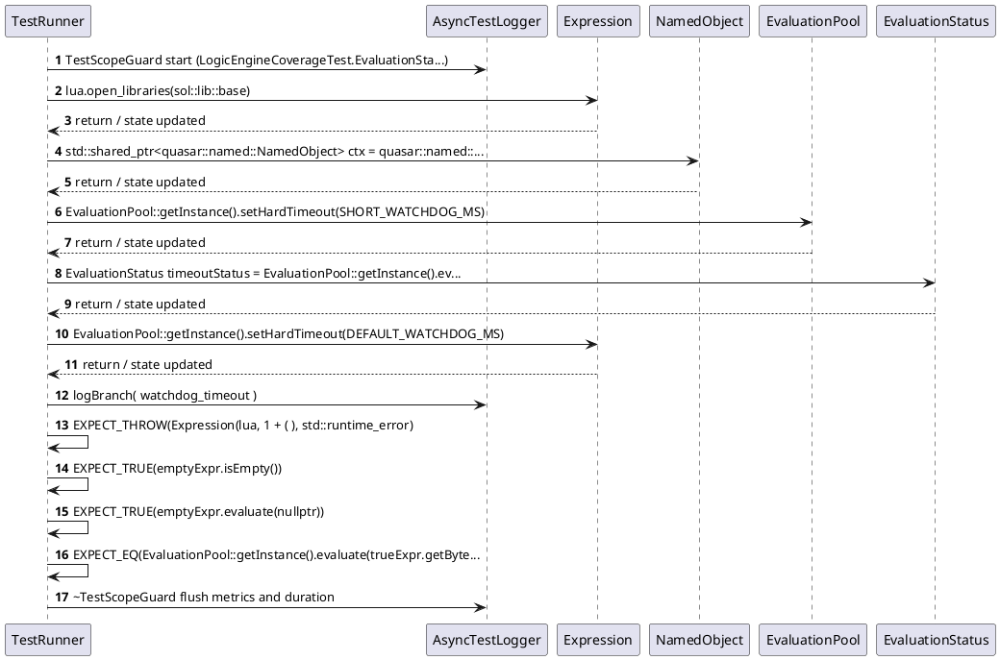

# Test Case: `LogicEngineCoverageTest.EvaluationStatusesExceptionsAndBitVectorOps`

| Property | Value |
| :--- | :--- |
| **Module** | `logicengine` |
| **Source File** | `cmake-projects/logicengine/test_cs0100/TestLogicEngineExtended.cpp` (lines 205–247) |
| **Category** | Coverage, Enum, Boundary & Exception Containment (`CS-0100.1`, `CS-0100.3`, `CS-0100.4`, `CS-0100.6`, `CS-0100.9`) |
| **Traceability** | `[TSK-20260311-009]`, `[FE-0240]`, `[FE-0240.1]` |
| **Async Telemetry** | Enabled (`TestScopeGuard` + `AsyncTestLogger`) |

## Summary

Extended CS-0100 test suite for `quasar_logicengine` covering Expression Lua compilation/evaluation, EvaluationPool timeouts/status enums, StateMachine invariants/failure states, SFC parallel steps, and CauseEffectMatrix bit-vector stress.

## Sequence Diagram

## Observed Operations

- `lua.open_libraries(sol::lib::base)`
- `std::shared_ptr<quasar::named::NamedObject> ctx = quasar::named::NamedObject::create("PoolCtx")`
- `EvaluationPool::getInstance().setHardTimeout(SHORT_WATCHDOG_MS)`
- `EvaluationStatus timeoutStatus = EvaluationPool::getInstance().evaluate(loopExpr.getBytecode(), ctx)`
- `EvaluationPool::getInstance().setHardTimeout(DEFAULT_WATCHDOG_MS)`
- `logBranch("watchdog_timeout")`
- `a.set(0U, true)`
- `a.set(129U, true)`

## Verification Assertions

- `EXPECT_THROW(Expression(lua, "1 + ("), std::runtime_error)`
- `EXPECT_TRUE(emptyExpr.isEmpty())`
- `EXPECT_TRUE(emptyExpr.evaluate(nullptr))`
- `EXPECT_EQ(EvaluationPool::getInstance().evaluate(trueExpr.getBytecode(), ctx), EvaluationStatus::Success)`
- `EXPECT_EQ(EvaluationPool::getInstance().evaluate(falseExpr.getBytecode(), ctx), EvaluationStatus::LogicFalse)`
- `EXPECT_EQ(EvaluationPool::getInstance().evaluate(errExpr.getBytecode(), ctx), EvaluationStatus::Error)`
- `EXPECT_EQ(timeoutStatus, EvaluationStatus::Timeout)`
- `EXPECT_NE(a, b)`
- `EXPECT_TRUE(c.any())`
- `EXPECT_EQ(c, b)`

---

[Back to `logicengine` Tests Overview](../logicengine.md)
