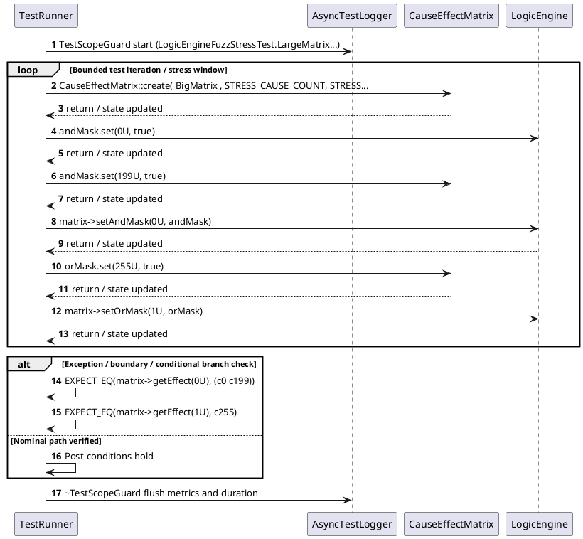

# Test Case: `LogicEngineFuzzStressTest.LargeMatrixFuzzAndConcurrentLogicEngineStress`

| Property | Value |
| :--- | :--- |
| **Module** | `logicengine` |
| **Source File** | `cmake-projects/logicengine/test_cs0100/TestLogicEngineExtended.cpp` (lines 249–311) |
| **Category** | Determinism, Fuzzing, Concurrency & Stress (`CS-0100.7`, `CS-0100.10`, `CS-0100.11`, `CS-0100.12`) |
| **Traceability** | `[TSK-20260311-009]`, `[FE-0240]`, `[FE-0240.1]` |
| **Async Telemetry** | Enabled (`TestScopeGuard` + `AsyncTestLogger`) |

## Summary

Extended CS-0100 test suite for `quasar_logicengine` covering Expression Lua compilation/evaluation, EvaluationPool timeouts/status enums, StateMachine invariants/failure states, SFC parallel steps, and CauseEffectMatrix bit-vector stress.

## Sequence Diagram

## Observed Operations

- `CauseEffectMatrix::create("BigMatrix", STRESS_CAUSE_COUNT, STRESS_EFFECT_COUNT)`
- `andMask.set(0U, true)`
- `andMask.set(199U, true)`
- `matrix->setAndMask(0U, andMask)`
- `orMask.set(255U, true)`
- `matrix->setOrMask(1U, orMask)`
- `matrix->initialize()`
- `matrix->start()`

## Verification Assertions

- `EXPECT_EQ(matrix->getEffect(0U), (c0 && c199))`
- `EXPECT_EQ(matrix->getEffect(1U), c255)`

---

[Back to `logicengine` Tests Overview](../logicengine.md)
