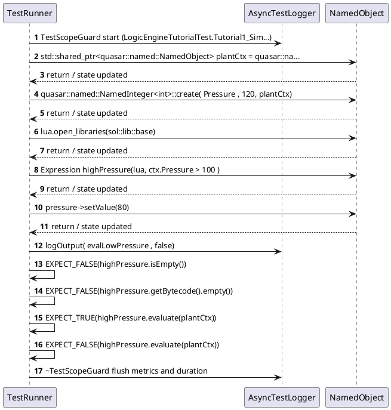

# Test Case: `LogicEngineTutorialTest.Tutorial1_SimpleLuaExpressionEvaluation`

| Property | Value |
| :--- | :--- |
| **Module** | `logicengine` |
| **Source File** | `cmake-projects/logicengine/test_cs0100/TestLogicEngineExtended.cpp` (lines 100–120) |
| **Category** | Pedagogical Tutorial (`CS-0100.19`) |
| **Traceability** | `[TSK-20260311-009]`, `[FE-0240]`, `[FE-0240.1]` |
| **Async Telemetry** | Enabled (`TestScopeGuard` + `AsyncTestLogger`) |

## Summary

Extended CS-0100 test suite for `quasar_logicengine` covering Expression Lua compilation/evaluation, EvaluationPool timeouts/status enums, StateMachine invariants/failure states, SFC parallel steps, and CauseEffectMatrix bit-vector stress.

## Sequence Diagram

## Observed Operations

- `std::shared_ptr<quasar::named::NamedObject> plantCtx = quasar::named::NamedObject::create("Plant")`
- `quasar::named::NamedInteger<int>::create("Pressure", 120, plantCtx)`
- `lua.open_libraries(sol::lib::base)`
- `Expression highPressure(lua, "ctx.Pressure > 100")`
- `pressure->setValue(80)`
- `logOutput("evalLowPressure", false)`

## Verification Assertions

- `EXPECT_FALSE(highPressure.isEmpty())`
- `EXPECT_FALSE(highPressure.getBytecode().empty())`
- `EXPECT_TRUE(highPressure.evaluate(plantCtx))`
- `EXPECT_FALSE(highPressure.evaluate(plantCtx))`

---

[Back to `logicengine` Tests Overview](../logicengine.md)
