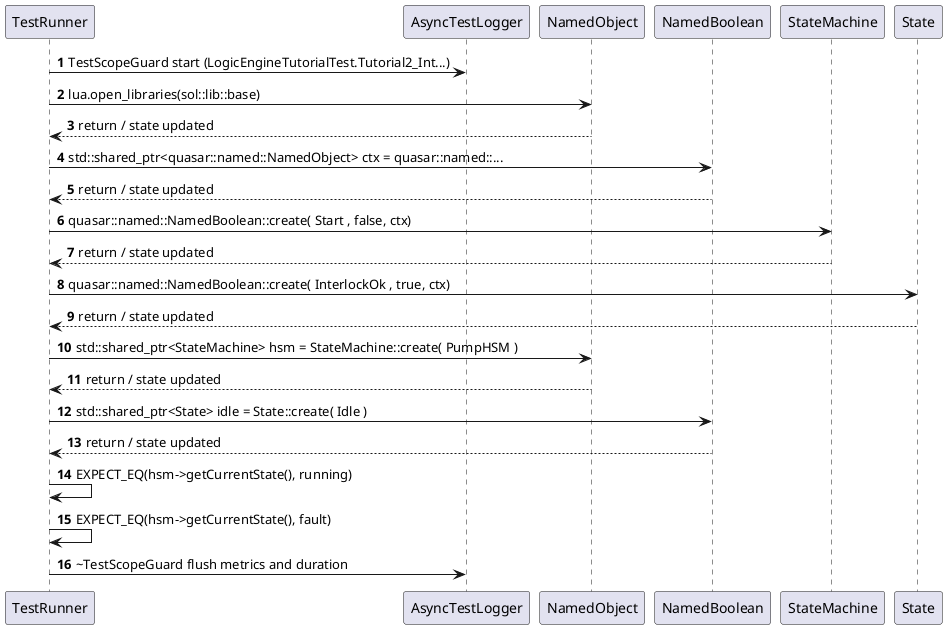

# Test Case: `LogicEngineTutorialTest.Tutorial2_IntermediateHierarchicalStateMachineWithInvariant`

| Property | Value |
| :--- | :--- |
| **Module** | `logicengine` |
| **Source File** | `cmake-projects/logicengine/test_cs0100/TestLogicEngineExtended.cpp` (lines 122–160) |
| **Category** | Pedagogical Tutorial (`CS-0100.19`) |
| **Traceability** | `[TSK-20260311-009]`, `[FE-0240]`, `[FE-0240.1]` |
| **Async Telemetry** | Enabled (`TestScopeGuard` + `AsyncTestLogger`) |

## Summary

Extended CS-0100 test suite for `quasar_logicengine` covering Expression Lua compilation/evaluation, EvaluationPool timeouts/status enums, StateMachine invariants/failure states, SFC parallel steps, and CauseEffectMatrix bit-vector stress.

## Sequence Diagram

## Observed Operations

- `lua.open_libraries(sol::lib::base)`
- `std::shared_ptr<quasar::named::NamedObject> ctx = quasar::named::NamedObject::create("Context")`
- `quasar::named::NamedBoolean::create("Start", false, ctx)`
- `quasar::named::NamedBoolean::create("InterlockOk", true, ctx)`
- `std::shared_ptr<StateMachine> hsm = StateMachine::create("PumpHSM")`
- `std::shared_ptr<State> idle = State::create("Idle")`
- `std::shared_ptr<State> running = State::create("Running")`
- `std::shared_ptr<State> fault = State::create("Fault")`

## Verification Assertions

- `EXPECT_EQ(hsm->getCurrentState(), running)`
- `EXPECT_EQ(hsm->getCurrentState(), fault)`

---

[Back to `logicengine` Tests Overview](../logicengine.md)
