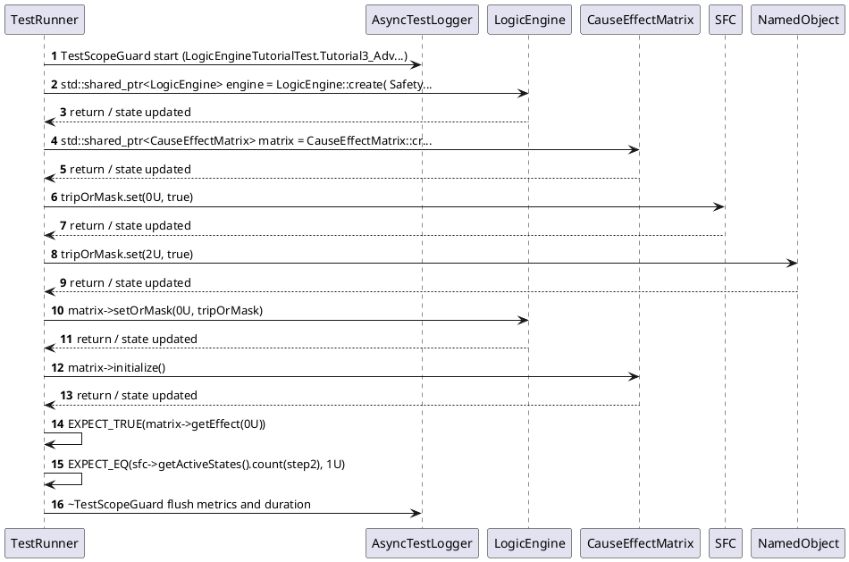

# Test Case: `LogicEngineTutorialTest.Tutorial3_AdvancedEngineOrchestratingSfcAndCauseEffect`

| Property | Value |
| :--- | :--- |
| **Module** | `logicengine` |
| **Source File** | `cmake-projects/logicengine/test_cs0100/TestLogicEngineExtended.cpp` (lines 162–203) |
| **Category** | Pedagogical Tutorial (`CS-0100.19`) |
| **Traceability** | `[TSK-20260311-009]`, `[FE-0240]`, `[FE-0240.1]` |
| **Async Telemetry** | Enabled (`TestScopeGuard` + `AsyncTestLogger`) |

## Summary

Extended CS-0100 test suite for `quasar_logicengine` covering Expression Lua compilation/evaluation, EvaluationPool timeouts/status enums, StateMachine invariants/failure states, SFC parallel steps, and CauseEffectMatrix bit-vector stress.

## Sequence Diagram

## Observed Operations

- `std::shared_ptr<LogicEngine> engine = LogicEngine::create("SafetyLine")`
- `std::shared_ptr<CauseEffectMatrix> matrix = CauseEffectMatrix::create("TripMatrix", 4U, 2U)`
- `tripOrMask.set(0U, true)`
- `tripOrMask.set(2U, true)`
- `matrix->setOrMask(0U, tripOrMask)`
- `matrix->initialize()`
- `matrix->start()`
- `std::shared_ptr<SFC> sfc = SFC::create("StartupSeq")`

## Verification Assertions

- `EXPECT_TRUE(matrix->getEffect(0U))`
- `EXPECT_EQ(sfc->getActiveStates().count(step2), 1U)`

---

[Back to `logicengine` Tests Overview](../logicengine.md)
