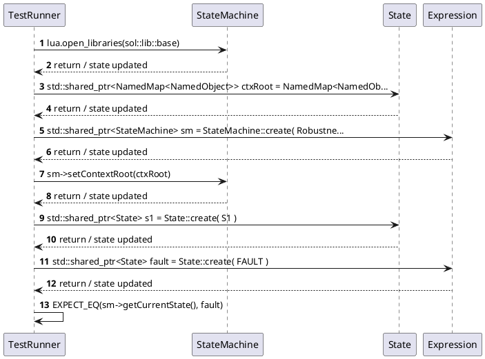

# Test Case: `LogicStressTest.InvalidTreeAccess`

| Property | Value |
| :--- | :--- |
| **Module** | `logicengine` |
| **Source File** | `cmake-projects/logicengine/test/LogicStressTest.cpp` (lines 37–59) |
| **Category** | Determinism, Fuzzing, Concurrency & Stress (`CS-0100.7`, `CS-0100.10`, `CS-0100.11`, `CS-0100.12`) |
| **Traceability** | See module specification (`FE-*` / `TSK-*`) |
| **Async Telemetry** | Standard GTest / CTest stdout |

## Summary

Executes verification scenario `LogicStressTest.InvalidTreeAccess` defined in `cmake-projects/logicengine/test/LogicStressTest.cpp`.

## Sequence Diagram

## Observed Operations

- `lua.open_libraries(sol::lib::base)`
- `std::shared_ptr<NamedMap<NamedObject>> ctxRoot = NamedMap<NamedObject>::create("ctx")`
- `std::shared_ptr<StateMachine> sm = StateMachine::create("RobustnessTest")`
- `sm->setContextRoot(ctxRoot)`
- `std::shared_ptr<State> s1 = State::create("S1")`
- `std::shared_ptr<State> fault = State::create("FAULT")`
- `s1->setInvariant(Expression(lua, "1 + nil == 2"))`
- `s1->setFailureState(fault)`

## Verification Assertions

- `EXPECT_EQ(sm->getCurrentState(), fault)`

---

[Back to `logicengine` Tests Overview](../logicengine.md)
