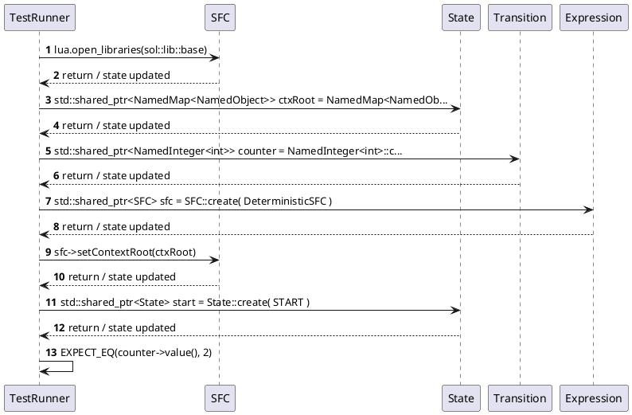

# Test Case: `LogicStressTest.ParallelDeterminism`

| Property | Value |
| :--- | :--- |
| **Module** | `logicengine` |
| **Source File** | `cmake-projects/logicengine/test/LogicStressTest.cpp` (lines 74–105) |
| **Category** | Determinism, Fuzzing, Concurrency & Stress (`CS-0100.7`, `CS-0100.10`, `CS-0100.11`, `CS-0100.12`) |
| **Traceability** | See module specification (`FE-*` / `TSK-*`) |
| **Async Telemetry** | Standard GTest / CTest stdout |

## Summary

Executes verification scenario `LogicStressTest.ParallelDeterminism` defined in `cmake-projects/logicengine/test/LogicStressTest.cpp`.

## Sequence Diagram

## Observed Operations

- `lua.open_libraries(sol::lib::base)`
- `std::shared_ptr<NamedMap<NamedObject>> ctxRoot = NamedMap<NamedObject>::create("ctx")`
- `std::shared_ptr<NamedInteger<int>> counter = NamedInteger<int>::create("counter", 0, ctxRoot)`
- `std::shared_ptr<SFC> sfc = SFC::create("DeterministicSFC")`
- `sfc->setContextRoot(ctxRoot)`
- `std::shared_ptr<State> start = State::create("START")`
- `std::shared_ptr<State> endA = State::create("ENDA")`
- `std::shared_ptr<State> endB = State::create("ENDB")`

## Verification Assertions

- `EXPECT_EQ(counter->value(), 2)`

---

[Back to `logicengine` Tests Overview](../logicengine.md)
