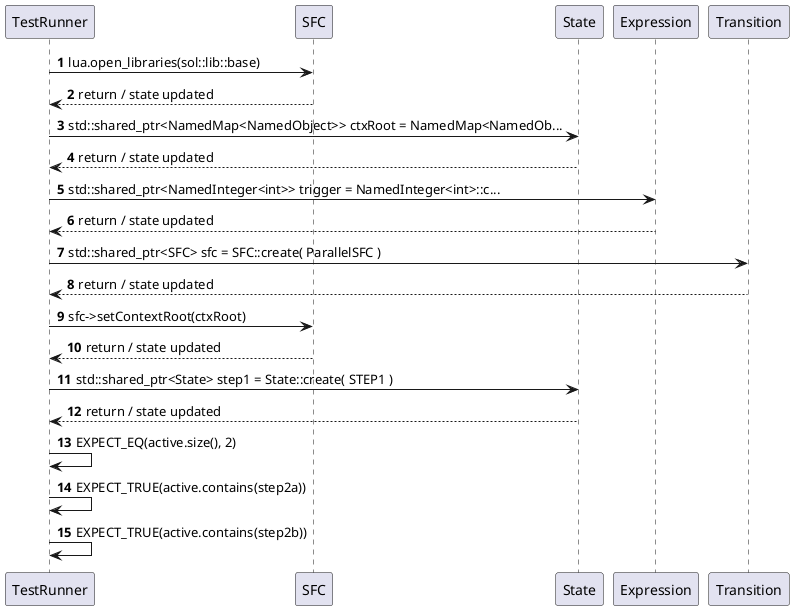

# Test Case: `SFCTest.ParallelExecution`

| Property | Value |
| :--- | :--- |
| **Module** | `logicengine` |
| **Source File** | `cmake-projects/logicengine/test/SFCTest.cpp` (lines 9–53) |
| **Category** | Unit & Regression Verification |
| **Traceability** | See module specification (`FE-*` / `TSK-*`) |
| **Async Telemetry** | Standard GTest / CTest stdout |

## Summary

Executes verification scenario `SFCTest.ParallelExecution` defined in `cmake-projects/logicengine/test/SFCTest.cpp`.

## Sequence Diagram

## Observed Operations

- `lua.open_libraries(sol::lib::base)`
- `std::shared_ptr<NamedMap<NamedObject>> ctxRoot = NamedMap<NamedObject>::create("ctx")`
- `std::shared_ptr<NamedInteger<int>> trigger = NamedInteger<int>::create("trigger", 0, ctxRoot)`
- `std::shared_ptr<SFC> sfc = SFC::create("ParallelSFC")`
- `sfc->setContextRoot(ctxRoot)`
- `std::shared_ptr<State> step1 = State::create("STEP1")`
- `std::shared_ptr<State> step2a = State::create("STEP2A")`
- `std::shared_ptr<State> step2b = State::create("STEP2B")`

## Verification Assertions

- `EXPECT_EQ(active.size(), 2)`
- `EXPECT_TRUE(active.contains(step2a))`
- `EXPECT_TRUE(active.contains(step2b))`

---

[Back to `logicengine` Tests Overview](../logicengine.md)
