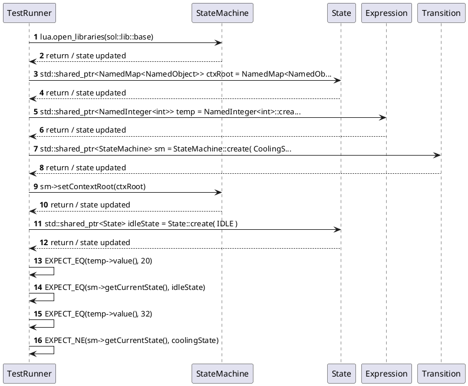

# Test Case: `StateMachineTest.TransactionalSafety`

| Property | Value |
| :--- | :--- |
| **Module** | `logicengine` |
| **Source File** | `cmake-projects/logicengine/test/StateMachineTest.cpp` (lines 26–71) |
| **Category** | Unit & Regression Verification |
| **Traceability** | See module specification (`FE-*` / `TSK-*`) |
| **Async Telemetry** | Standard GTest / CTest stdout |

## Summary

Executes verification scenario `StateMachineTest.TransactionalSafety` defined in `cmake-projects/logicengine/test/StateMachineTest.cpp`.

## Sequence Diagram

## Observed Operations

- `lua.open_libraries(sol::lib::base)`
- `std::shared_ptr<NamedMap<NamedObject>> ctxRoot = NamedMap<NamedObject>::create("ctx")`
- `std::shared_ptr<NamedInteger<int>> temp = NamedInteger<int>::create("temperature", 20, ctxRoot)`
- `std::shared_ptr<StateMachine> sm = StateMachine::create("CoolingSystem")`
- `sm->setContextRoot(ctxRoot)`
- `std::shared_ptr<State> idleState = State::create("IDLE")`
- `std::shared_ptr<State> coolingState = State::create("COOLING")`
- `std::shared_ptr<State> alarmState = State::create("ALARM")`

## Verification Assertions

- `EXPECT_EQ(temp->value(), 20)`
- `EXPECT_EQ(sm->getCurrentState(), idleState)`
- `EXPECT_EQ(temp->value(), 32)`
- `EXPECT_NE(sm->getCurrentState(), coolingState)`
- `EXPECT_NE(sm->getCurrentState(), idleState)`

---

[Back to `logicengine` Tests Overview](../logicengine.md)
