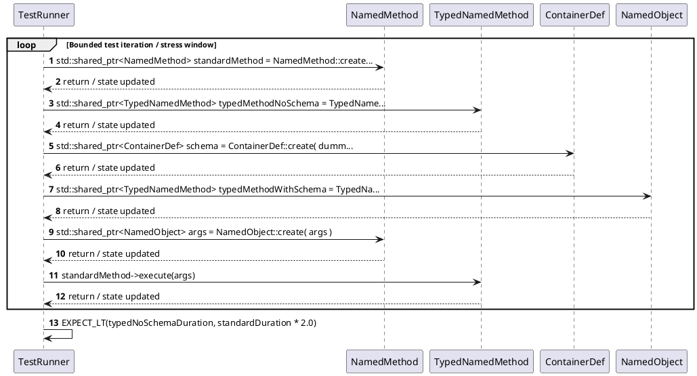

# Test Case: `MethodPerformanceTest.CallOverheadComparison`

| Property | Value |
| :--- | :--- |
| **Module** | `named` |
| **Source File** | `cmake-projects/named/test/TestMethodPerformance.cpp` (lines 19–75) |
| **Category** | Determinism, Fuzzing, Concurrency & Stress (`CS-0100.7`, `CS-0100.10`, `CS-0100.11`, `CS-0100.12`) |
| **Traceability** | See module specification (`FE-*` / `TSK-*`) |
| **Async Telemetry** | Standard GTest / CTest stdout |

## Summary

Benchmark comparing standard NamedMethod vs TypedNamedMethod call overhead.

## Sequence Diagram

## Observed Operations

- `std::shared_ptr<NamedMethod> standardMethod = NamedMethod::create("standard",  {`
- `std::shared_ptr<TypedNamedMethod> typedMethodNoSchema = TypedNamedMethod::create("typed_no_schema",  {`
- `std::shared_ptr<ContainerDef> schema = ContainerDef::create("dummy_schema")`
- `std::shared_ptr<TypedNamedMethod> typedMethodWithSchema = TypedNamedMethod::create("typed_with_schema",  {`
- `std::shared_ptr<NamedObject> args = NamedObject::create("args")`
- `standardMethod->execute(args)`
- `int64_t standardDuration = std::chrono::duration_cast<std::chrono::microseconds>(end - start).count()`
- `typedMethodNoSchema->execute(args)`

## Verification Assertions

- `EXPECT_LT(typedNoSchemaDuration, standardDuration * 2.0)`

---

[Back to `named` Tests Overview](../named.md)
