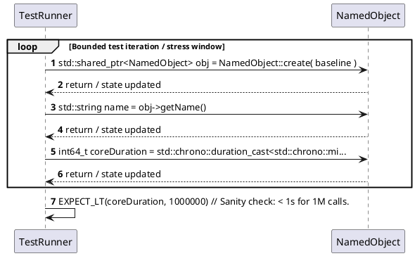

# Test Case: `MethodPerformanceTest.CoreNamedObjectIsolation`

| Property | Value |
| :--- | :--- |
| **Module** | `named` |
| **Source File** | `cmake-projects/named/test/TestMethodPerformance.cpp` (lines 80–98) |
| **Category** | Determinism, Fuzzing, Concurrency & Stress (`CS-0100.7`, `CS-0100.10`, `CS-0100.11`, `CS-0100.12`) |
| **Traceability** | See module specification (`FE-*` / `TSK-*`) |
| **Async Telemetry** | Standard GTest / CTest stdout |

## Summary

Benchmark to prove that new Typed subclasses don't slow down the core NamedObject.

## Sequence Diagram

## Observed Operations

- `std::shared_ptr<NamedObject> obj = NamedObject::create("baseline")`
- `std::string name = obj->getName()`
- `int64_t coreDuration = std::chrono::duration_cast<std::chrono::microseconds>(end - start).count()`

## Verification Assertions

- `EXPECT_LT(coreDuration, 1000000); // Sanity check: < 1s for 1M calls.`

---

[Back to `named` Tests Overview](../named.md)
