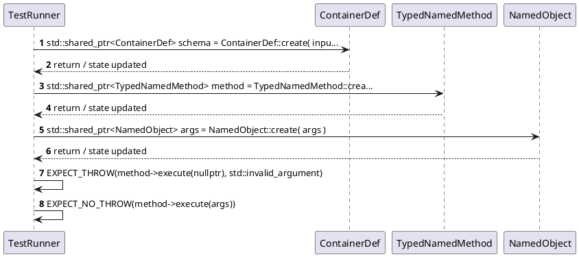

# Test Case: `MethodPerformanceTest.ValidationRejection`

| Property | Value |
| :--- | :--- |
| **Module** | `named` |
| **Source File** | `cmake-projects/named/test/TestMethodPerformance.cpp` (lines 103–116) |
| **Category** | Determinism, Fuzzing, Concurrency & Stress (`CS-0100.7`, `CS-0100.10`, `CS-0100.11`, `CS-0100.12`) |
| **Traceability** | See module specification (`FE-*` / `TSK-*`) |
| **Async Telemetry** | Standard GTest / CTest stdout |

## Summary

Verify that TypedNamedMethod rejects missing arguments when a schema is present.

## Sequence Diagram

## Observed Operations

- `std::shared_ptr<ContainerDef> schema = ContainerDef::create("input_schema")`
- `std::shared_ptr<TypedNamedMethod> method = TypedNamedMethod::create("test",  {`
- `std::shared_ptr<NamedObject> args = NamedObject::create("args")`

## Verification Assertions

- `EXPECT_THROW(method->execute(nullptr), std::invalid_argument)`
- `EXPECT_NO_THROW(method->execute(args))`

---

[Back to `named` Tests Overview](../named.md)
