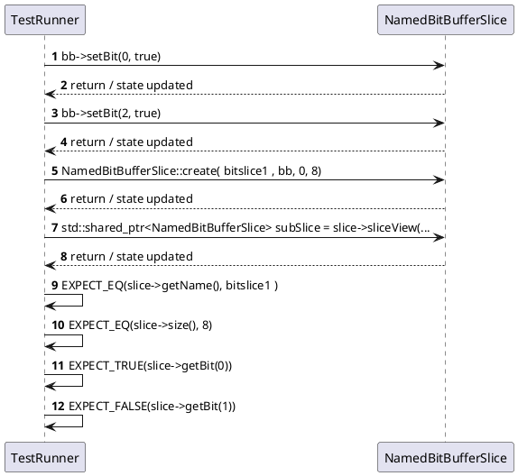

# Test Case: `NamedBitBufferSliceTest.CreationAndUsage`

| Property | Value |
| :--- | :--- |
| **Module** | `named` |
| **Source File** | `cmake-projects/named/test/TestNamedSlices.cpp` (lines 59–113) |
| **Category** | Unit & Regression Verification |
| **Traceability** | See module specification (`FE-*` / `TSK-*`) |
| **Async Telemetry** | Standard GTest / CTest stdout |

## Summary

Executes verification scenario `NamedBitBufferSliceTest.CreationAndUsage` defined in `cmake-projects/named/test/TestNamedSlices.cpp`.

## Sequence Diagram

## Observed Operations

- `bb->setBit(0, true)`
- `bb->setBit(2, true)`
- `NamedBitBufferSlice::create("bitslice1", bb, 0, 8)`
- `std::shared_ptr<NamedBitBufferSlice> subSlice = slice->sliceView(1, 4)`

## Verification Assertions

- `EXPECT_EQ(slice->getName(), "bitslice1")`
- `EXPECT_EQ(slice->size(), 8)`
- `EXPECT_TRUE(slice->getBit(0))`
- `EXPECT_FALSE(slice->getBit(1))`
- `EXPECT_TRUE(slice->getBit(2))`
- `EXPECT_EQ(subSlice->getName(), "bitslice1_slice")`
- `EXPECT_EQ(subSlice->size(), 4)`
- `EXPECT_FALSE(subSlice->getBit(0)); // bit 1 of original`
- `EXPECT_TRUE(subSlice->getBit(1)); // bit 2 of original`

---

[Back to `named` Tests Overview](../named.md)
