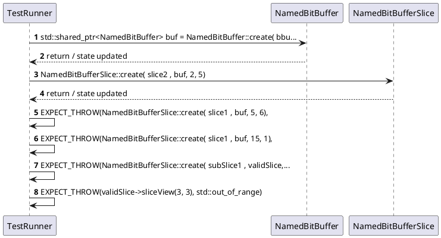

# Test Case: `NamedBitBufferSliceTest.OutOfBoundsTests`

| Property | Value |
| :--- | :--- |
| **Module** | `named` |
| **Source File** | `cmake-projects/named/test/TestNamedSlices.cpp` (lines 169–191) |
| **Category** | Coverage, Enum, Boundary & Exception Containment (`CS-0100.1`, `CS-0100.3`, `CS-0100.4`, `CS-0100.6`, `CS-0100.9`) |
| **Traceability** | See module specification (`FE-*` / `TSK-*`) |
| **Async Telemetry** | Standard GTest / CTest stdout |

## Summary

Executes verification scenario `NamedBitBufferSliceTest.OutOfBoundsTests` defined in `cmake-projects/named/test/TestNamedSlices.cpp`.

## Sequence Diagram

## Observed Operations

- `std::shared_ptr<NamedBitBuffer> buf = NamedBitBuffer::create("bbuf", 10)`
- `NamedBitBufferSlice::create("slice2", buf, 2, 5)`

## Verification Assertions

- `EXPECT_THROW(NamedBitBufferSlice::create("slice1", buf, 5, 6),`
- `EXPECT_THROW(NamedBitBufferSlice::create("slice1", buf, 15, 1),`
- `EXPECT_THROW(NamedBitBufferSlice::create("subSlice1", validSlice, 3, 3),`
- `EXPECT_THROW(validSlice->sliceView(3, 3), std::out_of_range)`

---

[Back to `named` Tests Overview](../named.md)
