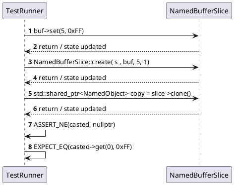

# Test Case: `NamedBufferSliceTest.Clone`

| Property | Value |
| :--- | :--- |
| **Module** | `named` |
| **Source File** | `cmake-projects/named/test/TestNamedSlices.cpp` (lines 115–144) |
| **Category** | Unit & Regression Verification |
| **Traceability** | See module specification (`FE-*` / `TSK-*`) |
| **Async Telemetry** | Standard GTest / CTest stdout |

## Summary

Executes verification scenario `NamedBufferSliceTest.Clone` defined in `cmake-projects/named/test/TestNamedSlices.cpp`.

## Sequence Diagram

## Observed Operations

- `buf->set(5, 0xFF)`
- `NamedBufferSlice::create("s", buf, 5, 1)`
- `std::shared_ptr<NamedObject> copy = slice->clone()`

## Verification Assertions

- `ASSERT_NE(casted, nullptr)`
- `EXPECT_EQ(casted->get(0), 0xFF)`

---

[Back to `named` Tests Overview](../named.md)
