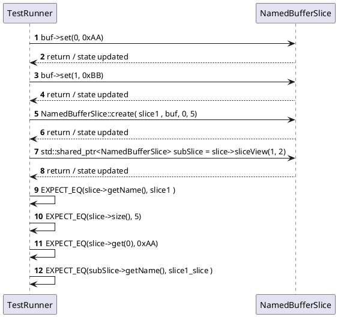

# Test Case: `NamedBufferSliceTest.CreationAndUsage`

| Property | Value |
| :--- | :--- |
| **Module** | `named` |
| **Source File** | `cmake-projects/named/test/TestNamedSlices.cpp` (lines 13–57) |
| **Category** | Unit & Regression Verification |
| **Traceability** | See module specification (`FE-*` / `TSK-*`) |
| **Async Telemetry** | Standard GTest / CTest stdout |

## Summary

Executes verification scenario `NamedBufferSliceTest.CreationAndUsage` defined in `cmake-projects/named/test/TestNamedSlices.cpp`.

## Sequence Diagram

## Observed Operations

- `buf->set(0, 0xAA)`
- `buf->set(1, 0xBB)`
- `NamedBufferSlice::create("slice1", buf, 0, 5)`
- `std::shared_ptr<NamedBufferSlice> subSlice = slice->sliceView(1, 2)`

## Verification Assertions

- `EXPECT_EQ(slice->getName(), "slice1")`
- `EXPECT_EQ(slice->size(), 5)`
- `EXPECT_EQ(slice->get(0), 0xAA)`
- `EXPECT_EQ(subSlice->getName(), "slice1_slice")`
- `EXPECT_EQ(subSlice->size(), 2)`
- `EXPECT_EQ(subSlice->get(0), 0xBB)`

---

[Back to `named` Tests Overview](../named.md)
