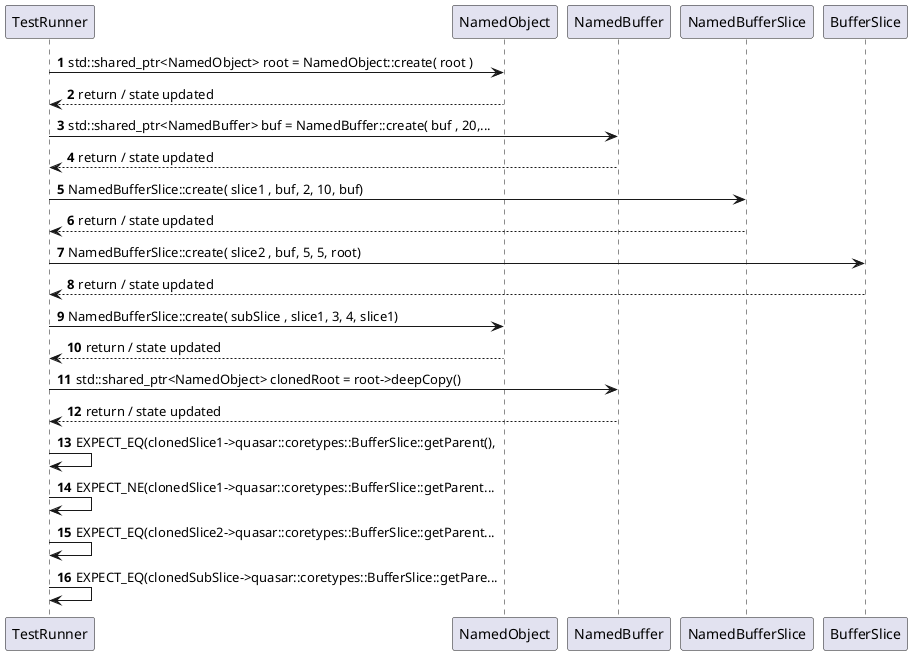

# Test Case: `NamedBufferSliceTest.DeepCopyRebasing`

| Property | Value |
| :--- | :--- |
| **Module** | `named` |
| **Source File** | `cmake-projects/named/test/TestNamedSlices.cpp` (lines 193–239) |
| **Category** | Unit & Regression Verification |
| **Traceability** | See module specification (`FE-*` / `TSK-*`) |
| **Async Telemetry** | Standard GTest / CTest stdout |

## Summary

Executes verification scenario `NamedBufferSliceTest.DeepCopyRebasing` defined in `cmake-projects/named/test/TestNamedSlices.cpp`.

## Sequence Diagram

## Observed Operations

- `std::shared_ptr<NamedObject> root = NamedObject::create("root")`
- `std::shared_ptr<NamedBuffer> buf = NamedBuffer::create("buf", 20, root)`
- `NamedBufferSlice::create("slice1", buf, 2, 10, buf)`
- `NamedBufferSlice::create("slice2", buf, 5, 5, root)`
- `NamedBufferSlice::create("subSlice", slice1, 3, 4, slice1)`
- `std::shared_ptr<NamedObject> clonedRoot = root->deepCopy()`
- `std::dynamic_pointer_cast<NamedBuffer>(clonedRoot->getFirstChild())`
- `std::dynamic_pointer_cast<NamedBufferSlice>(clonedRoot->getLastChild())`

## Verification Assertions

- `EXPECT_EQ(clonedSlice1->quasar::coretypes::BufferSlice::getParent(),`
- `EXPECT_NE(clonedSlice1->quasar::coretypes::BufferSlice::getParent(), buf)`
- `EXPECT_EQ(clonedSlice2->quasar::coretypes::BufferSlice::getParent(), buf)`
- `EXPECT_EQ(clonedSubSlice->quasar::coretypes::BufferSlice::getParent(),`
- `EXPECT_EQ(clonedSubSlice->getOffset(), 5)`

---

[Back to `named` Tests Overview](../named.md)
