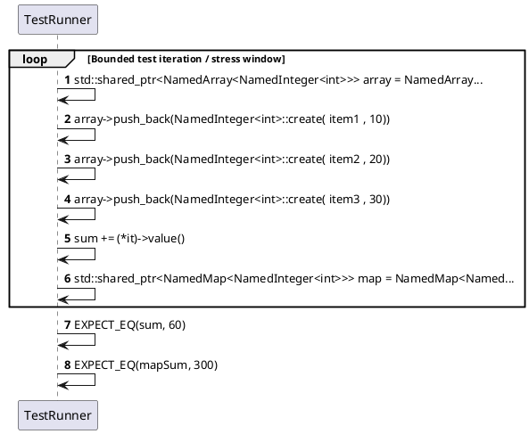

# Test Case: `NamedContainersTest.Iterators`

| Property | Value |
| :--- | :--- |
| **Module** | `named` |
| **Source File** | `cmake-projects/named/test/TestNamedContainers.cpp` (lines 90–112) |
| **Category** | Unit & Regression Verification |
| **Traceability** | See module specification (`FE-*` / `TSK-*`) |
| **Async Telemetry** | Standard GTest / CTest stdout |

## Summary

Executes verification scenario `NamedContainersTest.Iterators` defined in `cmake-projects/named/test/TestNamedContainers.cpp`.

## Sequence Diagram

## Observed Operations

- `std::shared_ptr<NamedArray<NamedInteger<int>>> array = NamedArray<NamedInteger<int>>::create("myArray")`
- `array->push_back(NamedInteger<int>::create("item1", 10))`
- `array->push_back(NamedInteger<int>::create("item2", 20))`
- `array->push_back(NamedInteger<int>::create("item3", 30))`
- `sum += (*it)->value()`
- `std::shared_ptr<NamedMap<NamedInteger<int>>> map = NamedMap<NamedInteger<int>>::create("myMap")`
- `map->put("A", NamedInteger<int>::create("A", 100))`
- `map->put("B", NamedInteger<int>::create("B", 200))`

## Verification Assertions

- `EXPECT_EQ(sum, 60)`
- `EXPECT_EQ(mapSum, 300)`

---

[Back to `named` Tests Overview](../named.md)
