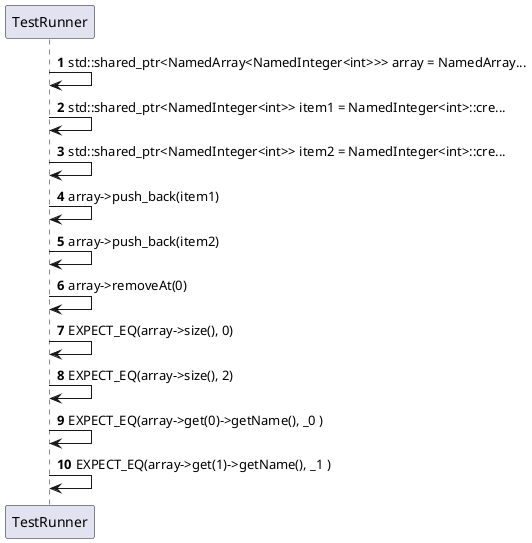

# Test Case: `NamedContainersTest.NamedArray`

| Property | Value |
| :--- | :--- |
| **Module** | `named` |
| **Source File** | `cmake-projects/named/test/TestNamedContainers.cpp` (lines 9–34) |
| **Category** | Unit & Regression Verification |
| **Traceability** | See module specification (`FE-*` / `TSK-*`) |
| **Async Telemetry** | Standard GTest / CTest stdout |

## Summary

Executes verification scenario `NamedContainersTest.NamedArray` defined in `cmake-projects/named/test/TestNamedContainers.cpp`.

## Sequence Diagram

## Observed Operations

- `std::shared_ptr<NamedArray<NamedInteger<int>>> array = NamedArray<NamedInteger<int>>::create("myArray")`
- `std::shared_ptr<NamedInteger<int>> item1 = NamedInteger<int>::create("temp1", 42)`
- `std::shared_ptr<NamedInteger<int>> item2 = NamedInteger<int>::create("temp2", 84)`
- `array->push_back(item1)`
- `array->push_back(item2)`
- `array->removeAt(0)`

## Verification Assertions

- `EXPECT_EQ(array->size(), 0)`
- `EXPECT_EQ(array->size(), 2)`
- `EXPECT_EQ(array->get(0)->getName(), "_0")`
- `EXPECT_EQ(array->get(1)->getName(), "_1")`
- `EXPECT_EQ(array->getChildren().size(), 2)`
- `EXPECT_EQ(array->size(), 1)`
- `EXPECT_EQ(array->get(0)->value(), 84)`
- `EXPECT_EQ(array->get(0)->getName(), "_0")`

---

[Back to `named` Tests Overview](../named.md)
