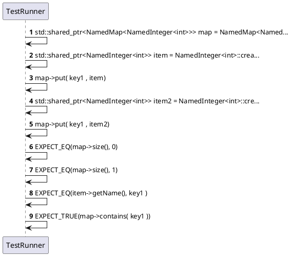

# Test Case: `NamedContainersTest.NamedMap`

| Property | Value |
| :--- | :--- |
| **Module** | `named` |
| **Source File** | `cmake-projects/named/test/TestNamedContainers.cpp` (lines 36–60) |
| **Category** | Unit & Regression Verification |
| **Traceability** | See module specification (`FE-*` / `TSK-*`) |
| **Async Telemetry** | Standard GTest / CTest stdout |

## Summary

Executes verification scenario `NamedContainersTest.NamedMap` defined in `cmake-projects/named/test/TestNamedContainers.cpp`.

## Sequence Diagram

## Observed Operations

- `std::shared_ptr<NamedMap<NamedInteger<int>>> map = NamedMap<NamedInteger<int>>::create("myMap")`
- `std::shared_ptr<NamedInteger<int>> item = NamedInteger<int>::create("temp", 100)`
- `map->put("key1", item)`
- `std::shared_ptr<NamedInteger<int>> item2 = NamedInteger<int>::create("temp2", 200)`
- `map->put("key1", item2)`

## Verification Assertions

- `EXPECT_EQ(map->size(), 0)`
- `EXPECT_EQ(map->size(), 1)`
- `EXPECT_EQ(item->getName(), "key1")`
- `EXPECT_TRUE(map->contains("key1"))`
- `EXPECT_EQ(map->get("key1")->value(), 100)`
- `EXPECT_EQ(map->size(), 1)`
- `EXPECT_EQ(map->get("key1")->value(), 200)`
- `EXPECT_TRUE(map->remove("key1"))`
- `EXPECT_EQ(map->size(), 0)`
- `EXPECT_FALSE(map->remove("key1")); // Safe to remove non-existent`

---

[Back to `named` Tests Overview](../named.md)
