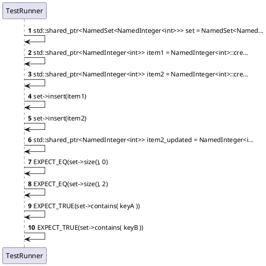

# Test Case: `NamedContainersTest.NamedSet`

| Property | Value |
| :--- | :--- |
| **Module** | `named` |
| **Source File** | `cmake-projects/named/test/TestNamedContainers.cpp` (lines 62–88) |
| **Category** | Unit & Regression Verification |
| **Traceability** | See module specification (`FE-*` / `TSK-*`) |
| **Async Telemetry** | Standard GTest / CTest stdout |

## Summary

Executes verification scenario `NamedContainersTest.NamedSet` defined in `cmake-projects/named/test/TestNamedContainers.cpp`.

## Sequence Diagram

## Observed Operations

- `std::shared_ptr<NamedSet<NamedInteger<int>>> set = NamedSet<NamedInteger<int>>::create("mySet")`
- `std::shared_ptr<NamedInteger<int>> item1 = NamedInteger<int>::create("keyA", 1)`
- `std::shared_ptr<NamedInteger<int>> item2 = NamedInteger<int>::create("keyB", 2)`
- `set->insert(item1)`
- `set->insert(item2)`
- `std::shared_ptr<NamedInteger<int>> item2_updated = NamedInteger<int>::create("keyB", 200)`
- `set->insert(item2_updated)`

## Verification Assertions

- `EXPECT_EQ(set->size(), 0)`
- `EXPECT_EQ(set->size(), 2)`
- `EXPECT_TRUE(set->contains("keyA"))`
- `EXPECT_TRUE(set->contains("keyB"))`
- `EXPECT_EQ(set->get("keyA")->value(), 1)`
- `EXPECT_TRUE(set->remove("keyA"))`
- `EXPECT_EQ(set->size(), 1)`
- `EXPECT_FALSE(set->contains("keyA"))`
- `EXPECT_EQ(set->size(), 1)`
- `EXPECT_EQ(set->get("keyB")->value(), 200)`

---

[Back to `named` Tests Overview](../named.md)
