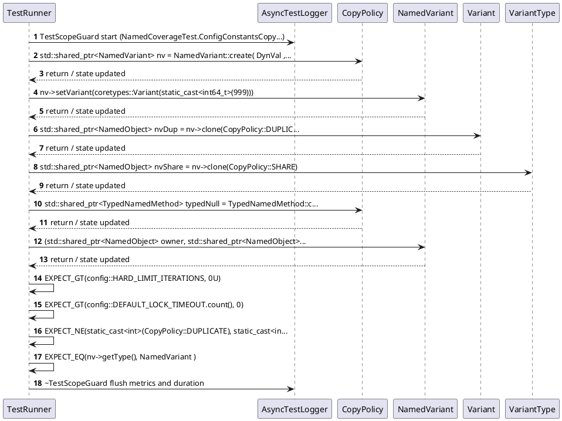

# Test Case: `NamedCoverageTest.ConfigConstantsCopyPoliciesVariantAndErrorBranches`

| Property | Value |
| :--- | :--- |
| **Module** | `named` |
| **Source File** | `cmake-projects/named/test_cs0100/TestNamedExtended.cpp` (lines 196–227) |
| **Category** | Coverage, Enum, Boundary & Exception Containment (`CS-0100.1`, `CS-0100.3`, `CS-0100.4`, `CS-0100.6`, `CS-0100.9`) |
| **Traceability** | `[TSK-20260328-001]`, `[TSK-20260311-001]`, `[FE-0260]`, `[FE-0150]` |
| **Async Telemetry** | Enabled (`TestScopeGuard` + `AsyncTestLogger`) |

## Summary

Extended CS-0100 test suite for `quasar_named` covering reflexive methods, web methods, traversal rules, CopyPolicy, and temporal/quantity/variant nodes.

## Sequence Diagram

## Observed Operations

- `std::shared_ptr<NamedVariant> nv = NamedVariant::create("DynVal", coretypes::Variant(true))`
- `nv->setVariant(coretypes::Variant(static_cast<int64_t>(999)))`
- `std::shared_ptr<NamedObject> nvDup = nv->clone(CopyPolicy::DUPLICATE)`
- `std::shared_ptr<NamedObject> nvShare = nv->clone(CopyPolicy::SHARE)`
- `std::shared_ptr<TypedNamedMethod> typedNull = TypedNamedMethod::create(`
- ` -> std::shared_ptr<NamedObject> {`
- `return NamedBoolean::create("done", true)`
- `std::shared_ptr<NamedObject> emptyArgs = NamedObject::create("EmptyArgs")`

## Verification Assertions

- `EXPECT_GT(config::HARD_LIMIT_ITERATIONS, 0U)`
- `EXPECT_GT(config::DEFAULT_LOCK_TIMEOUT.count(), 0)`
- `EXPECT_NE(static_cast<int>(CopyPolicy::DUPLICATE), static_cast<int>(CopyPolicy::SHARE))`
- `EXPECT_EQ(nv->getType(), "NamedVariant")`
- `EXPECT_EQ(nv->getVariantType(), coretypes::VariantType::Boolean)`
- `EXPECT_EQ(nv->getAs<int64_t>(), 999)`
- `EXPECT_EQ(nvDup->getType(), "NamedVariant")`
- `EXPECT_EQ(nvShare->getType(), "NamedVariant")`
- `EXPECT_EQ(typedNull->getType(), "TypedNamedMethod")`
- `EXPECT_TRUE(typedNull->validateInput(*emptyArgs).has_value())`

---

[Back to `named` Tests Overview](../named.md)
