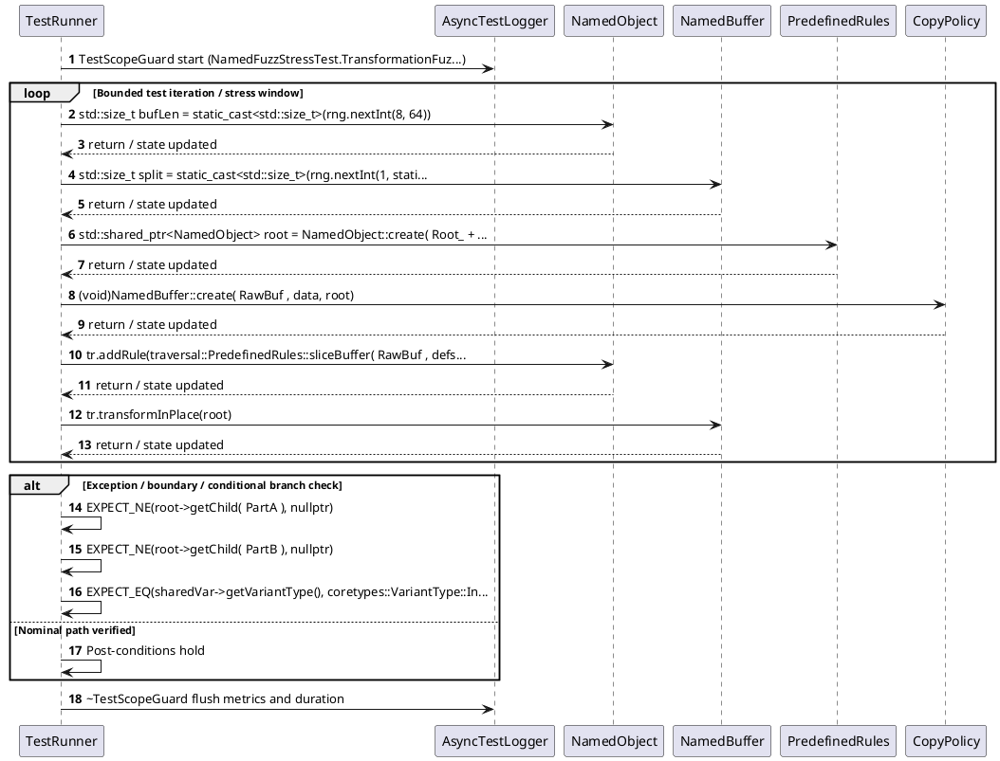

# Test Case: `NamedFuzzStressTest.TransformationFuzzAndConcurrentNamedVariantStress`

| Property | Value |
| :--- | :--- |
| **Module** | `named` |
| **Source File** | `cmake-projects/named/test_cs0100/TestNamedExtended.cpp` (lines 229–291) |
| **Category** | Determinism, Fuzzing, Concurrency & Stress (`CS-0100.7`, `CS-0100.10`, `CS-0100.11`, `CS-0100.12`) |
| **Traceability** | `[TSK-20260328-001]`, `[TSK-20260311-001]`, `[FE-0260]`, `[FE-0150]` |
| **Async Telemetry** | Enabled (`TestScopeGuard` + `AsyncTestLogger`) |

## Summary

Extended CS-0100 test suite for `quasar_named` covering reflexive methods, web methods, traversal rules, CopyPolicy, and temporal/quantity/variant nodes.

## Sequence Diagram

## Observed Operations

- `std::size_t bufLen = static_cast<std::size_t>(rng.nextInt(8, 64))`
- `std::size_t split = static_cast<std::size_t>(rng.nextInt(1, static_cast<int>(bufLen - 1U)))`
- `std::shared_ptr<NamedObject> root = NamedObject::create("Root_" + std::to_string(iter))`
- `(void)NamedBuffer::create("RawBuf", data, root)`
- `tr.addRule(traversal::PredefinedRules::sliceBuffer("RawBuf", defs, CopyPolicy::DUPLICATE, 5))`
- `tr.transformInPlace(root)`
- `NamedVariant::create("SharedTelemetry", coretypes::Variant(static_cast<int64_t>(0)))`
- `threads.reserve(NAMED_STRESS_THREADS)`

## Verification Assertions

- `EXPECT_NE(root->getChild("PartA"), nullptr)`
- `EXPECT_NE(root->getChild("PartB"), nullptr)`
- `EXPECT_EQ(sharedVar->getVariantType(), coretypes::VariantType::Integer)`

---

[Back to `named` Tests Overview](../named.md)
